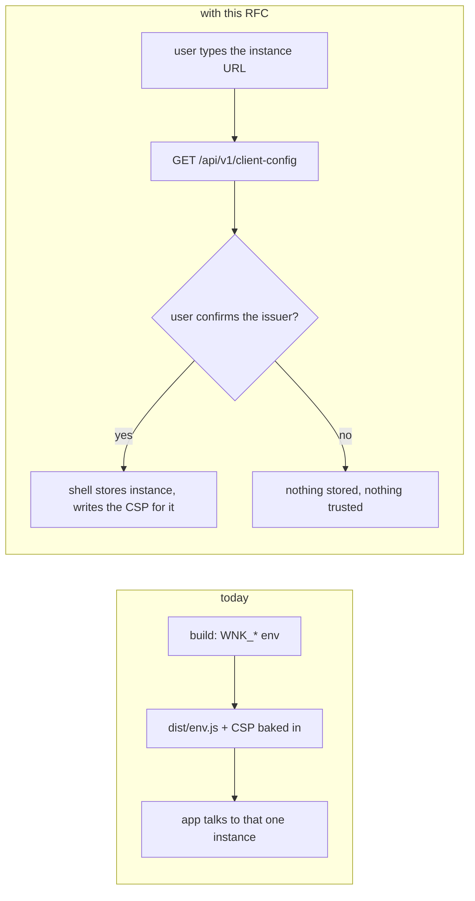
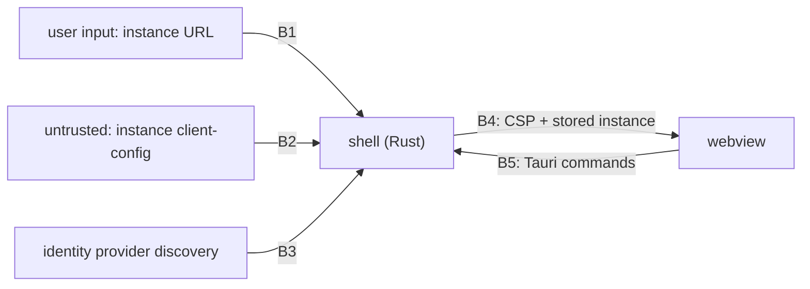

| Field       | Value |
| ----------- | ----- |
| Status      | Implemented (2026-10-28; phases 1 to 3, phase 4 belongs to the M6 RFC; decisions 1, 2, 4 and 5 in §15, question 3 still open; the delta is §17; §6.P not recorded) |
| Short       | Instance chosen at first launch |
| Settles     | How one desktop (later mobile) build finds, trusts and remembers the instance it talks to |
| Author      | Max Batleforc &lt;maxleriche.60@gmail.com&gt; |
| Co-author   | Claude Opus 5.5 |
| Created     | 2026-10-26 |
| Supersedes  | — |
| Touches     | `crates/notify-adapters/http-actix` (one route), `crates/notify-server` (config read), `web/src-tauri` (instance store, CSP hook, credential keys), `web/src/config.ts`, `web/src/auth`, `web/vite.config.ts`, `web/scripts/tauri-csp.ts`, `.github/workflows/publish-main.yaml`, docs |
| Risk        | medium — §7: the user now picks which server, and which identity provider, the app trusts |

---

## 1. Summary

A desktop bundle is built for one instance: `desktopEnv` in `web/vite.config.ts`
writes `window.__ENV__` into `dist/env.js`, and `web/scripts/tauri-csp.ts` pins
the shell's CSP to that instance's API and identity-provider origins. Anyone
running another instance has to rebuild the app, and a store build (mobile,
M6/M7) cannot exist at all.

With this RFC the shell asks for one URL at first launch, fetches the
instance's public client settings from a new unauthenticated route, shows the
user which identity provider they are about to sign in at, and remembers the
answer. The CSP stays as strict as today: the shell writes it per instance
when it serves the bundle, instead of at build time. A managed deployment can
still bake a preset instance into its build.

### Before / after

```text
# today: one bundle per instance, decided at build time
WNK_DESKTOP_API_BASE_URL=https://notify.example.org \
WNK_DESKTOP_OIDC_ISSUER=https://auth.example.org task tauri:bundle

# with this RFC: one bundle, the instance asked once
task tauri:bundle                     # no WNK_* needed
→ first launch: "Server: https://notify.example.org"
→ "You will sign in at auth.example.org — continue?"
```



The newly trusted thing is the instance the user typed, and through it the
issuer it names; both are shown and confirmed before anything is stored.

---

## 2. Motivation

1. **A desktop build serves exactly one instance.** `desktopEnv`
   (`web/vite.config.ts:112`) writes the API and issuer into `dist/env.js`, and
   `tauri-csp.ts` derives `connect-src`/`img-src` from the same variables. A
   second instance means a second build, signed and distributed separately.
2. **`publish-main` cannot produce a usable desktop artefact without picking
   an instance.** Since 2026-10-25 the desktop bundle step is skipped unless
   `WNK_DESKTOP_API_BASE_URL` is set; the per-commit desktop build therefore
   builds nothing for anyone.
3. **Mobile store builds are impossible under the current model.** Android
   (M6) and iOS (M7) distribute one signed binary through a store or
   Obtainium; there is no per-deployment build step to bake `env.js` into.
4. **The CLI already has multiple instances and the shell does not.**
   `notify-client-core`'s `Profile { url }` (`config.rs:15`) names a server per
   profile, and the desktop shell shares that store (§9.3bis) but only ever
   uses `DEFAULT_PROFILE` (`credential.rs:96`).

---

## 3. Goals / non-goals

**Goals**

- One desktop binary works against any weebo-notify instance, chosen at first
  launch and changeable later.
- The shell's CSP keeps naming exact origins (no `https:` wildcard).
- The user sees, and confirms, the identity provider before signing in.
- A token obtained for one instance is never sent to, or readable for,
  another.
- Managed deployments can still ship a build with a preset (and optionally
  locked) instance.

**Non-goals**

- Several instances signed in at once: one active instance; switching signs
  out. Multi-account is a UI and storage project of its own.
- Instance discovery (mDNS, a directory, a QR code): the user types a URL.
- Mobile push, device keys and the mobile OAuth callback: listed in §15 as
  open, settled by the M6 RFC; this RFC only makes the store build possible.
- Changing the web image: it is served by its instance and keeps reading
  `env.js` rendered at container boot (ADR-0021).
- Routing the front's network through Rust IPC (the §10bis.1 façade): it
  would also solve the CSP, at the cost of a rewrite (§12).

---

## 4. User-facing design

### 4.1 Configuration

Server, `config.toml`, nothing new: the route reads what already exists.

```toml
[oidc]
issuer = "https://auth.example.org/application/o/weebo-notify/"
client_id = "weebo-notify"

[attachments]          # optional; its public origin, if any, is published too
```

Build, all optional now:

| Variable | Absent | Set |
| --- | --- | --- |
| `WNK_DESKTOP_API_BASE_URL` | first launch asks | the URL field is prefilled |
| `WNK_DESKTOP_LOCK_INSTANCE=1` | the user may change it | the field is fixed (managed deployments) |

The safe default is "ask": nothing is trusted until the user confirms it.

### 4.2 Behaviour rules

- The URL is normalised to its origin plus an optional path prefix: scheme and
  host lowercased, trailing slash dropped, no query, fragment or userinfo.
- First launch, or no stored instance: the instance screen is the only route;
  the router guard sends everything there.
- A stored instance: the app starts on it as today; the instance screen is
  reachable from Settings ("Change server"), which signs out first.
- `client-config` answering 404 means "not a weebo-notify instance, or too
  old": the screen says so instead of retrying.

### 4.3 Validation

Refused, nothing stored:

| Condition | Rationale |
| --- | --- |
| scheme other than `https`, except `http` to a loopback host in a dev build | a token must not cross the network in clear |
| userinfo, query or fragment in the URL | ambiguity is how a URL ends up meaning another host |
| `client-config` not JSON, over 16 KiB, or slower than 10 s | a hostile or broken server must not hang or bloat the shell |
| issuer not `https` (same loopback exception) | as above, for the identity provider |
| the issuer's discovery document fails `discovery.ts`'s checks (issuer match, every endpoint on the issuer's origin, S256) | same rules as the web client, unchanged |
| the user declines the confirmation | the user, not the server, decides whom to trust |

Warnings:

| Condition | Behaviour | Surfaced in |
| --- | --- | --- |
| instance and issuer on unrelated domains | allowed (Authentik is often elsewhere), the confirmation names both hosts | the confirmation screen |
| `attachment_origin` absent | attachments load from the API origin | none needed |

### 4.4 API surface

| Method | Path | Auth | Who may call | Limit |
| --- | --- | --- | --- | --- |
| GET | `/api/v1/client-config` | none | anyone | the ingress's per-address limit (`hardening.mdx`) |

```json
{ "oidc_issuer": "https://auth.example.org/application/o/weebo-notify/",
  "oidc_client_id": "weebo-notify",
  "attachment_origin": "https://files.example.org" }
```

Handler annotated with utoipa; the TypeScript client is regenerated by
`task recu` (HeyApi).

---

## 5. Architecture

### 5.1 First launch

```mermaid
sequenceDiagram
    participant U as user
    participant W as webview (bundled UI)
    participant R as shell (Rust)
    participant I as instance API
    participant P as identity provider
    U->>W: "https://notify.example.org"
    W->>R: instance_probe(url)
    R->>I: GET /api/v1/client-config (10 s, 16 KiB)
    I-->>R: issuer, client_id, attachment_origin
    R->>P: GET .well-known/openid-configuration
    P-->>R: endpoints (same-origin, S256)
    R-->>W: "sign in at auth.example.org?"
    U->>W: confirm
    W->>R: instance_save(...)
    R->>R: store instance; reload main window
    Note over R,W: the reload is served with a CSP built from the stored origins
```

The probe runs in Rust because, before an instance is chosen, the CSP allows
no remote origin at all: the webview cannot fetch the instance it is being
asked about, which is the point.

### 5.2 Where the CSP comes from

`WebviewWindowBuilder::on_web_resource_request` (Tauri 2.12.5,
`src/webview/webview_window.rs:235`; its own doc example rewrites the
`Content-Security-Policy` of a bundled HTML response) is attached where the
main window is built (`web/src-tauri/src/lib.rs:403`). For `tauri:` responses
carrying a CSP it replaces `connect-src` and `img-src` with the stored
instance's API, issuer and attachment origins, computed by the same rules as
`web/src/lib/csp.ts`. With no stored instance it writes the bundle's own
build-time CSP, which names no remote origin.

**Invariant:** because the CSP is written by the shell from the stored
instance on every page load, and the front cannot store an instance without
`instance_save` (a Tauri command granted to `main` only), script running in
the webview cannot add an origin to its own CSP.

### 5.3 Tokens per instance

The vault entry and the `0600` fallback are keyed by an instance id (the
normalised origin) instead of `DEFAULT_PROFILE`; `credential_load` only ever
reads the active instance's entry, and "Change server" calls `logout` (which
revokes, since 06ff7ab) before switching. `credential_session` keeps its
current check (https, or http to loopback) on the URL it is handed.

---

## 6. Detailed design

### 6.1 Server

- `crates/notify-adapters/http-actix`: `GET /api/v1/client-config`, no
  extractor for auth, values from `Config.oidc` and the attachment store's
  public origin. Cached response headers (`Cache-Control: max-age=300`).
- No new configuration, no database access.

### 6.2 Shell

- `instance.rs` (new): `instance_probe` (fetch, size and time limits,
  discovery checks), `instance_save`, `instance_current`, `instance_clear`;
  storage in the client-core store directory (`0700`), one TOML file.
  `instance_probe` keeps its checked result in the shell and returns an opaque
  id; `instance_save` takes only that id, so the webview can confirm what Rust
  probed but cannot hand the shell an instance of its own making. It then asks
  the user through a native message dialog (`tauri-plugin-dialog`, called from
  Rust, no dialog permission granted to the webview) naming the instance and
  the issuer host, and stores nothing unless the user accepts.
- `lib.rs`: the `on_web_resource_request` hook; capability `default.json`
  gains the four `allow-instance-*` permissions, `build.rs` declares them.
- `credential.rs`: entries keyed by instance id.
- `oauth.rs`: unchanged (the loopback redirect is instance-independent).

### 6.3 Front

- `web/src/config.ts`: on desktop, values come from `instance_current()`
  (async, before the app mounts) instead of `window.__ENV__`; the web build
  keeps `env.js`.
- `views/InstanceView.vue`: URL field, confirmation naming both hosts, errors.
- `web/vite.config.ts` `desktopEnv` and `tauri-csp.ts`: no instance origins at
  build time; `WNK_DESKTOP_*` become the preset/lock described in §4.1.
- `publish-main.yaml`: the desktop bundle no longer depends on
  `WNK_DESKTOP_API_BASE_URL`, the skip added on 2026-10-25 goes.

### 6.P Proof against a real client

Client: the AppImage built by `task tauri:bundle` (Tauri 2.12.5) on Fedora 44,
against the dev stack (`task dev:core`, the oidc mock) and the e2e stack.

1. Fresh profile, launch — only the instance screen renders; the webview's
   console shows no request to any remote origin.
2. Enter `http://localhost:8080` in a dev build — `GET /api/v1/client-config`
   is seen in the server log, then the confirmation names `localhost:9110`;
   confirm; the sign-in completes through the loopback redirect.
3. Inspect the reloaded page's response headers (devtools) — `connect-src`
   lists exactly the API and issuer origins, nothing else.
4. **Refusal:** enter `http://notify.example.org` in a release build —
   refused before any request (no line in any server log), the screen says
   why.
5. **Refusal:** an instance whose `client-config` names an issuer whose
   discovery points `token_endpoint` at another origin — refused with
   `discovery.ts`'s message; nothing written to the store.
6. **Refusal:** from the webview's console, `fetch("https://example.com")`
   after setup — blocked by the CSP, and no `instance_save` is reachable to
   widen it (the capability test proves the command is denied to any other
   window).
7. Change server — the previous instance's refresh token is revoked
   (provider log) and its vault entry is gone (`secret-tool search service
   weebo-notify`).

**Deliberately untouched**, so reviewers do not go looking:

- `web/nginx/`, `env.js.template` — the web image keeps its boot-time config.
- `oauth.rs` — the loopback port and redirect are the same for every instance.
- `crates/notify-cli/src/login.rs` — the CLI's API-key login is unchanged.

---

## 7. Security

**Rating:** medium — the user can now point the app at any server, and that
server names the identity provider the user will type a password into.

### 7.1 Threat model

Assets: the user's IdP credentials, the refresh token, the content of their
notifications. Actors: a hostile instance (or a hostile link pushing one), a
hostile page or process on the device (ADR-0023 adversary 7), script injected
into the webview (adversary 6).



| # | Threat (STRIDE) | Where | Mitigation | Residual risk |
| --- | --- | --- | --- | --- |
| T1 | Spoofing: a hostile instance names a look-alike issuer to phish credentials | B2 | the confirmation shows the issuer host before any sign-in (`InstanceView.vue`); the login happens in the system browser, where the real URL bar shows | a user who confirms a look-alike host is phished; accepted by the maintainer, as for any typed URL |
| T2 | Elevation: injected script widens the CSP to exfiltrate | B4/B5 | the CSP is written by the shell from the store (`lib.rs` hook); `instance_save` takes only a probe id issued by Rust, and stores nothing until the user accepts a **native** dialog (decision 5) that script in the webview cannot click | none known |
| T3 | Information disclosure: a token sent to the wrong instance after a switch | B5 | vault keyed by instance id (`credential.rs`); switching revokes and clears (`session.ts` `logout`) | none known |
| T4 | Tampering: a link or another app sets the instance (`weebo-notify://instance?...`) | B1 | no deep link touches the instance; the parser accepts `/n/` and `/c/` only (`notify-client-core/src/deeplink.rs`) | none |
| T5 | Denial of service: a slow or huge `client-config` hangs the shell | B2 | 10 s timeout, 16 KiB cap in `instance_probe` | none |
| T6 | Information disclosure: `client-config` leaks configuration | server | it returns the issuer, client id and attachment origin, all already public in the web image's `env.js` | none |
| T7 | Spoofing: a downgrade to `http` exposes tokens | B1/B2 | `https` required for instance and issuer, loopback `http` in dev builds only (compile-time flag) | none |

### 7.2 Authentication and authorisation

`client-config` is unauthenticated by design: it is what the app reads before
it can authenticate. A bypass gains nothing: the values are public. The new
Tauri commands are granted to the `main` window only, declared in the app
manifest (`build.rs`), so another window or a remote page cannot call them.

### 7.3 Input handling and injection

The URL is parsed with `url::Url`, normalised, and refused on userinfo, query
or fragment; the response is size- and time-bounded; issuer and origins are
re-parsed and checked for scheme before use. The CSP is assembled from parsed
origins only, never from raw strings, so a value cannot inject a directive.
`instance_probe` gets a fuzz target for the URL normaliser.

### 7.4 Secrets and cryptography

No new secret. The refresh token keeps its vault storage, now keyed per
instance. No new cryptography.

### 7.5 Abuse and resource exhaustion

The route does no I/O beyond reading configuration; the ingress limits apply.
The shell makes two outbound requests per probe, bounded as above.

### 7.6 Existing defences that still hold

PKCE S256 and `state` (and the loopback state filter of 71f88eb),
`discovery.ts`'s same-origin and issuer checks, `credential_session`'s URL
check, the markdown sanitiser, sign-out revocation (06ff7ab).

---

## 8. Supply chain

| Dependency / image / tool | Version | Why this one | Licence | Known CVEs (`task audit`) | Maintenance |
| --- | --- | --- | --- | --- | --- |
| `tauri-plugin-dialog` | 2.8.3 (latest stable, 2026-10-14) | the native confirmation of decision 5; the official plugin, called from Rust only | Apache-2.0 OR MIT | checked by `task audit` in Phase 2 | Tauri organisation, released with Tauri |
| (already present) | — | `url`, `reqwest`, `serde` are in the shell's tree | — | — | — |

- **Build and release**: the desktop bundle no longer needs instance variables;
  `publish-main` builds it on every push again. No image change.
- **Updates**: unchanged.

---

## 9. Data and privacy

| Data | Personal? | Where stored | Retention | Who can read it | Leaves the instance? |
| --- | --- | --- | --- | --- | --- |
| chosen instance URL, issuer, client id, attachment origin | no (server addresses) | client-core store dir, `0700` | until "Change server" or uninstall | the local user | no |
| `client-config` request in the server's access log | the client IP, as any request | server logs | the server's log retention | the operator | no |

No personal data is added; the vault entry keeps holding only the token.

---

## 10. Operability

### 10.1 Observability

- **Metrics**: the route is counted by the existing per-route HTTP metrics; no
  new label.
- **Logs and audit trail**: none for the route (public, read-only). The shell
  logs probe failures to stderr with the reason, never the token.
- **Alerts**: none, because a failing probe is a user-facing message, not an
  operator incident.

### 10.2 Failure modes

| Failure | Detected by | Behaviour (fail open / closed) | Recovery |
| --- | --- | --- | --- |
| instance unreachable at first launch | probe timeout | closed: nothing stored, the screen says so | retry |
| stored instance unreachable later | API calls fail | as today (offline state, cached inbox) | none needed |
| store file corrupt | parse error at start | closed: back to the instance screen | re-enter the URL |
| CSP hook absent (platform without it) | the §6.P check 3 | closed: the build-time CSP names no remote origin, the app cannot connect | treated as a release blocker |

### 10.3 Performance and capacity

One extra request at first launch; the route answers from memory. The CSP
rewrite runs once per HTML response.

---

## 11. Other concerns

- **Accessibility**: one new screen, built with the existing form components;
  keyboard path and labels checked by `accessibilite-check`.
- **Internationalisation**: new strings in `fr` and `en`.
- **Compliance**: none touched.
- **Licensing**: unchanged.
- **Documentation**: `clients/desktop` (first launch), `ops/configuration`
  (the IdP must register the loopback redirect for desktop users), the Tauri
  README (build variables now optional).

---

## 12. Alternatives considered

| Alternative | Why rejected |
| --- | --- |
| Keep one build per instance (do nothing) | every operator rebuilds and signs; mobile store builds stay impossible |
| `connect-src https:` and `img-src https:` | injected script could send data to any host; the CSP stops being a defence |
| Route all network through Rust IPC (§10bis.1 façade) | solves the CSP completely, but rewrites the API client, the stream and attachments; worth its own RFC |
| Ask for API URL, issuer and client id separately | three fields the user can get wrong, and no confirmation of what the server itself publishes |
| A deep link or QR code that sets the instance | a hostile link would choose the user's server for them (T4) |

---

## 13. Rollout and compatibility

- **Default behaviour**: a build without `WNK_DESKTOP_*` asks at first launch.
- **Migration**: an installed build with a baked instance keeps working; on
  first start of the new version the baked values become the stored instance,
  and the vault entry under `default` is moved to the instance id.
- **Operator prerequisites**: the IdP registers
  `http://127.0.0.1:1420/auth/callback` for the public client (already in
  `dev/authentik/blueprints/weebo-notify.yaml`); `client-config` reachable
  through the ingress.
- **Rollback**: an older shell ignores the store file and goes back to its
  baked instance; nothing closed in §7 reopens.

---

## 14. Test plan

- **Unit** (`web/src-tauri/src/instance.rs`): URL normalisation and refusals;
  probe limits; CSP assembly from origins.
- **Unit** (`web/src/config.ts`, `InstanceView.vue`): desktop reads the shell,
  web reads `env.js`; confirmation shows both hosts.
- **Integration** (`crates/notify-adapters/http-actix`): `client-config`
  returns the configured values, without auth, with the cache header.
- **Proof**: §6.P.
- **Security**: T2 — a second window cannot call `instance_save` (capability
  test), and `instance_save` with an unknown probe id or a declined dialog
  stores nothing; T3 — switching instance revokes and empties the vault entry; T4 —
  `weebo-notify://instance?...` is refused by the deep-link parser; T5 — a
  server that drips bytes or sends 1 MiB is cut off; T7 — `http://` refused in
  a release build. Fuzz target for the URL normaliser (`fuzz/`).
- **Audit**: `task audit` green; no new dependency.
- **Existing suites**: `desktop` (clippy, tests), `oidc-compat`, `e2e`, the
  web unit tests, `audit:dast` (the new route is scanned unauthenticated).

---

## 15. Decisions and open questions

### Resolved

| # | Question | Decision |
| --- | --- | --- |
| 1 | Where does the shell learn the issuer? | **From the instance, `GET /api/v1/client-config`.** One field for the user, and the values are those the server already validates tokens against. |
| 2 | How is the CSP kept strict? | **Rewritten by the shell per instance (`on_web_resource_request`).** Verified to exist in Tauri 2.12.5; keeps exact origins. |
| 4 | The mobile OAuth callback | **Custom scheme `weebo-notify://oauth/callback` with PKCE** (decided 2026-10-26 by the maintainer, as recommended). App Links cannot be verified for an arbitrary instance's domain from a store build; RFC 8252 §8.1 accepts a custom scheme with PKCE for native apps. Each IdP registers that redirect for mobile users; the M6 RFC carries the rest. |
| 5 | Is a probe id enough against T2? | **No: saving also requires a native dialog** (decided 2026-10-26 by the maintainer, as recommended). Script in the webview can call commands but cannot click a dialog drawn by the OS. Adds `tauri-plugin-dialog` (§8). |

### Still open

3. **Does `on_web_resource_request` rewrite bundled responses on Android and
   iOS as on desktop?** If not, mobile needs the IPC façade or a per-platform
   answer. Recommendation: prove it on Android before Phase 2 merges.

---

## 16. Implementation phases

| Phase | Content |
| --- | --- |
| 1 | Server route `client-config` + utoipa + regenerated client + tests. Useful alone (the web client could use it too). |
| 2 | Shell: instance store, probe, CSP hook, credential keys, capability; front `config.ts` on desktop; migration of a baked instance. The CSP hook lands with the store, never after. |
| 3 | `InstanceView.vue`, Settings "Change server", i18n, docs; `publish-main` builds the desktop bundle unconditionally. |
| 4 | Mobile: the answer to open question 3, and decision 4 carried out, in the M6 RFC. |

---

## 17. Revision against the tree (2026-10-28)

Phases 1 to 3 shipped on 2026-10-26 (`5504f46` and the commits around it); the
status was left at *Draft*. This section is the check made on 2026-10-28 against
the tree, and what it changed. Phase 4 (mobile) is, as planned, the M6 RFC's.

### 17.1 Where the tree differs, and why

| # | The RFC says | The tree does | Why |
| --- | --- | --- | --- |
| 1 | `WNK_DESKTOP_API_BASE_URL` prefills the URL field; `WNK_DESKTOP_LOCK_INSTANCE=1` locks it (§4.1) | a build given `WNK_API_BASE_URL` and the other `WNK_*` bakes the whole instance into `env.js` and starts on it: a preset is always locked, and there is no prefill and no lock variable. Since 2026-10-28 Settings says so instead of offering "Change server" (`isPresetInstance`) | Before, "Change server" on such a build signed out and forgot an instance that was never chosen, then reloaded onto the same baked server: a button that only signed you out. Found by this check |
| 2 | A router guard sends every route to the instance screen (§4.2) | `main.ts` boots a separate `instance-app` when nothing is chosen or baked | The instance screen needs none of the app's stores, router or session; the main app never mounts without an instance |
| 3 | `instance.rs` in the shell holds the probe (§6.2) | the probe, the normaliser, the discovery checks and the store live in `notify_client_core::instance`; the shell's `instance.rs` wraps them as commands and owns the dialog and `csp_for` | Kept in the client core with the rest of the client logic, so it is tested without a webview |
| 4 | `client-config` answering `404` gets its own message (§4.2) | any non-success answer is "not a weebo-notify instance: <url> answered <status>" | A `404`, a `502` from a proxy or a login page all mean "not this instance"; the status is in the message |
| 5 | Credentials keyed by instance id (§5.3) | keyed by the chosen instance's id; a preset build keeps `DEFAULT_PROFILE` | A preset build has one instance by construction; its existing vault entry stays readable across the upgrade |

### 17.2 Proof

- Server: the `client-config` test in `crates/notify-adapters/http-actix/tests/api.rs`
  (values, no auth, `Cache-Control`).
- `notify-client-core::instance`: normalisation, https-only with the loopback
  exception, ambiguous addresses refused, the issuer's discovery kept to its origin
  with S256, an end-to-end probe against a local server, a page that is not an
  instance refused, an oversized answer cut off, and the store kept to its directory.
- Shell: `csp_for` swaps exactly the built origins and touches nothing but
  `connect-src`/`img-src`; the `desktop` CI job (clippy, tests) is green on `main`.
- Web: `InstanceView.spec.ts`, and `ServerPanel.spec.ts` (2026-10-28) for row 1.
- `fuzz_instance_url` (2026-10-28): the normaliser over arbitrary text, 60 s,
  1 888 613 runs, no crash; whatever it accepts is https (or loopback http when
  allowed) with no userinfo, query or fragment.

**Not done**: the §6.P observations against a real AppImage (not recorded when the
phases landed, and not repeatable here without a desktop session); the capability
test that a second window cannot call `instance_save`; a server that drips bytes
(T5: only the oversized answer is tested); a deep link carrying an instance (T4) is
refused because the deep-link parser knows no such route, not by a test of its own.
