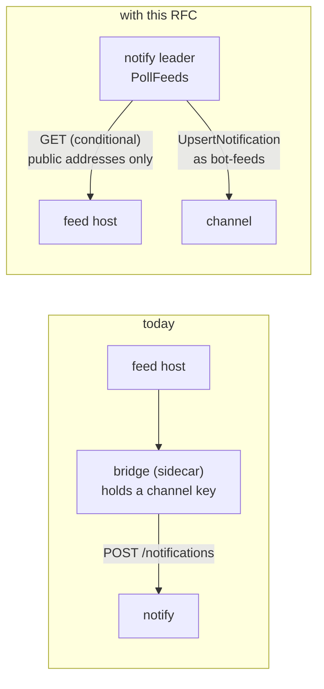
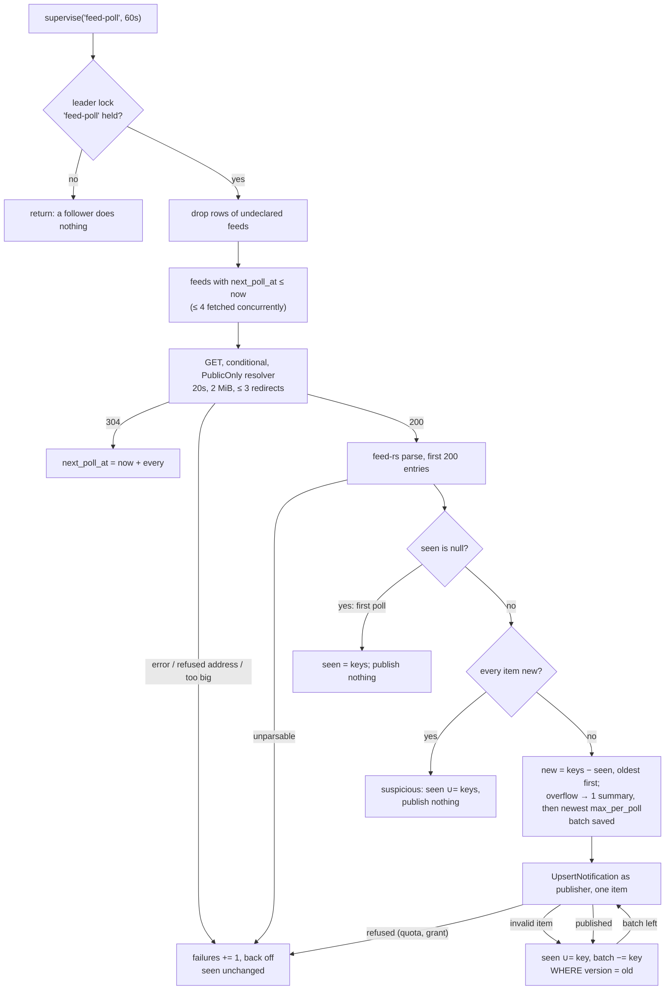
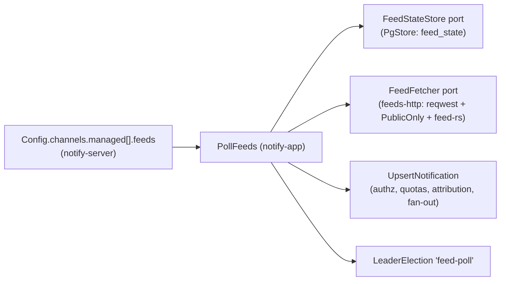
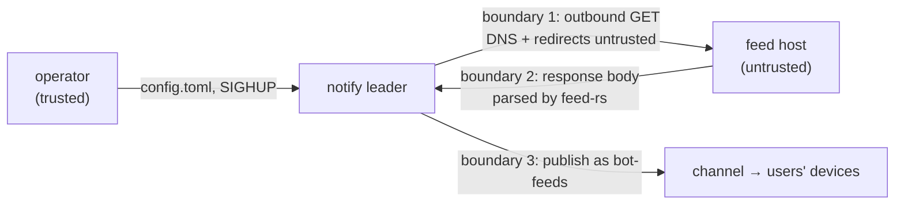

| Field       | Value |
| ----------- | ----- |
| Status      | Accepted (2026-10-27, after the six-lens panel; decisions 1 to 14 in §15) |
| Short       | Feeds as channel sources |
| Settles     | How a channel subscribes to RSS/Atom feeds: where they are declared, who publishes, what counts as new, and what the server may fetch |
| Author      | Max Batleforc &lt;maxleriche.60@gmail.com&gt; |
| Co-author   | Claude Opus 5.5 |
| Created     | 2026-10-27 |
| Supersedes  | — |
| Touches     | `crates/notify-server` (config, reconcile snapshot, wiring, one background loop), `crates/notify-app` (new `PollFeeds` use case), `crates/notify-ports` (new `FeedFetcher`, `FeedRegistry` and `FeedStateStore` ports, feed methods on `Metrics`, `InMemory`), `crates/notify-adapters/persistence-pg` (one migration), `crates/notify-adapters/push-http` (typed `PublicOnly` error), `crates/notify-adapters/metrics-prometheus`, the other reqwest clients (`.no_gzip()`, §6.5), new `crates/notify-adapters/feeds-http`, workspace `Cargo.toml` (reqwest `gzip`), `deny.toml`, docs |
| Risk        | medium — §7: the server now fetches and parses documents from URLs an operator names, on a timer |

<Callout>
  **Reference material.** About 8 000 words: §1 to §4 are the proposal, the
  rest is the design and its proof, read when building or reviewing it.
</Callout>

---

## 1. Summary

Today every notification arrives because a publisher pushed it: a user, a
service account, a channel key or a CI job calling `POST` or `PUT`
(`crates/notify-app/src/publish.rs`). Following a blog, a release page or a
status feed means running a bridge next to the instance and giving it a key.

With this RFC, a `[[channels.managed]]` block gains `[[channels.managed.feeds]]`
entries. The leader polls each feed on its own interval, works out which items
it has not seen, and publishes each one into the channel through the existing
`UpsertNotification`. It publishes as a service account the operator names, so
authorisation, quotas and attribution are the publish path's own. The first
poll of a feed publishes nothing: it only records what is already there. A feed
is a **source** on an ordinary channel, not a new channel type. Members, TTL,
DND, push and outbound sinks work unchanged.

### Before / after

```toml
# today: a sidecar bridge polls the feed and POSTs with a channel key
[[channels.managed]]
id = "veille-rust"
access = [{ oidc_group = "dev", scopes = ["subscribe"] }]

# with this RFC
[[service_accounts]]
id = "bot-feeds"
display_name = "Flux RSS"

[[channels.managed]]
id = "veille-rust"
access = [
  { oidc_group = "dev", scopes = ["subscribe"] },
  { service_account = "bot-feeds", scopes = ["publish"] },
]

[[channels.managed.feeds]]
url = "https://blog.rust-lang.org/feed.xml"
publisher = "bot-feeds"
every = "30m"

[[channels.managed.feeds]]
url = "https://github.com/batleforc/weebo-notify-v2/releases.atom"
publisher = "bot-feeds"
tags = ["release"]
```



The arrow that changes direction is the point: the server now makes an
outbound request it did not make before. That request is the one §7 bounds.

---

## 2. Motivation

1. **Following a feed needs a second process.** No route or job reads anything
   from outside: the only writers are the `PublishNotification` and
   `UpsertNotification` use cases, and both are driven by an inbound request.
   An operator who wants release notes in a channel deploys, keys and monitors
   a bridge.
2. **That bridge holds a long-lived publish key.** A `ChannelKey` or a
   service-account API key lives in the bridge's environment
   (`Principal::ChannelKey`, `crates/notify-domain/src/principal.rs`). An
   in-process poller needs no credential at all: it acts as a declared service
   account and never mints a token.
3. **A naive bridge floods or forgets.** Polling a feed and publishing what it
   contains republishes on restart, or after the channel's TTL purges an item
   that is still in the feed (the default TTL is a week; feeds keep items for
   months). Deduplication belongs next to the channel's own state, not in each
   bridge's local file.

---

## 3. Goals / non-goals

**Goals**

- A managed channel declares zero or more feeds in its GitOps config, reloaded
  on `SIGHUP` like its sinks.
- Each new item becomes exactly one notification, even across restarts,
  leader changes and TTL purges.
- Adding a feed never floods the channel: the first poll records and publishes
  nothing.
- RSS 0.9x/1.0/2.0, Atom and JSON Feed parse through one library.
- The server only fetches public addresses unless the operator opts a feed out,
  and every fetch is bounded in time, size and item count.

**Non-goals**

- **Feeds on dynamic channels, through the API or the UI.** Any channel manager
  could then make the server fetch a URL of their choice. That is the SSRF
  surface this RFC keeps operator-only (decision 1).
- **Authenticated feeds via headers or a `secret_ref`.** A token in the query
  string works and is redacted (§7.4). Header auth is a later *bis* if someone
  asks for it.
- **Rendering HTML summaries.** Notification bodies are Markdown with raw HTML
  inert (`crates/notify-domain/src/content.rs`), so a feed's HTML summary would
  arrive as escaped tags. v1 publishes the title, a *View* link and tags
  (decision 4).
- **Images and enclosures.** `ContentDraft::image` goes through the attachment
  path and its own checks. Fetching third-party images is a second outbound
  surface for no clear gain.
- **Fetching through an egress proxy.** The client ignores `HTTP(S)_PROXY`
  (§6.5), because a proxy resolves the name itself and `PublicOnly` would
  never be asked. An instance whose only egress is a proxy cannot use feeds
  in v1.
- **WebSub (PubSubHubbub) push.** It needs a public callback route, which is an
  unauthenticated inbound surface. Polling with conditional requests is cheap
  enough (§10.3).
- **Editing or retracting a notification when its item changes upstream.** An
  item is published once. Later edits to its title upstream are ignored, as
  long as the item has a `guid`/`id` or a link (§4.2); an item with neither
  is keyed on its title and date, so a retitle publishes it again.

---

## 4. User-facing design

### 4.1 Configuration

```toml
[[channels.managed.feeds]]
url = "https://example.org/feed.xml"  # http(s) only; no user:pass@
publisher = "bot-feeds"               # a [[service_accounts]] id holding `publish` here
every = "30m"                         # default 30m, floor 5m, ceiling 24h
tags = ["blog"]                       # added to every item; default none
max_per_poll = 10                     # default 10, ceiling 50
allow_private_network = false         # default false: refuse non-public addresses
lang = "en"                           # "en" or "fr"; the server-written strings
```

- **No feeds** (the field absent, or an empty list) means no poller work for
  that channel and no rows. An absent list is not serialised either, so the
  channel's snapshot is byte-for-byte the one the previous build stored (§6.1).
- **Unknown keys are refused** inside a feed table
  (`#[serde(deny_unknown_fields)]` on `Feed`, a new struct, so nothing that
  parses today stops parsing): `interval = "15m"` is an error, not a silent
  30m. With no feed anywhere, the job takes its leader
  lock, finds nothing due and returns.
- **`publisher` is required**, and there is no built-in identity. The items
  are attributed to a name the operator chose and can see in the console
  (`Attribution`, `crates/notify-app/src/attribution.rs`).
- **`allow_private_network` defaults to `false`**, the closed side: an
  operator must opt in to fetch an internal Gitea or GitLab, one feed at a
  time.
- A feed is identified by its channel and its exact URL, the way a sink is
  (ADR-0018). Changing the URL makes a new feed, which primes again and
  publishes nothing on its first poll.

### 4.2 Behaviour rules

- **Due**: a feed is polled when its `next_poll_at` has passed. After a success
  that is `every` later. After a failure it is
  `min(every × 2^failures, 24h)` (a saturating shift), or the server's
  `Retry-After` on a `429`/`503` if that is longer, itself clamped to 24h. A
  feed's first `next_poll_at` is spread by a random offset within `every`, so
  feeds primed at one boot do not stay in lockstep.
- **Conditional**: every request after the first sends `If-None-Match` and
  `If-Modified-Since` from the last answer. A `304` costs nothing more and
  counts as a success: it resets `failures`.
- **Item identity** (decision 10): the Atom `id` or the RSS `guid` when the
  feed gives one. Otherwise the adapter's own `id_generator`
  (`parser::Builder::id_generator`, replacing feed-rs's fallback, which hashes
  link plus title and ends in a random UUID): the first link alone, else the
  title plus `published`. An entry with none of these is skipped and counted
  `invalid`. Each item is keyed as `hex(sha256(feed key ‖ id))`, truncated to
  32 characters.
- **New** means a key in this fetch that is absent from the feed's stored
  `seen` list. `seen` is a **bounded union**: new keys are appended in order of
  first sight and the oldest dropped past 400, twice the parse window
  (§7.5). An item that leaves the feed and comes back within that memory, as
  with a CDN edge serving an older window, is not new again.
- **Suspicious fetch**: on a non-first poll where *every* parsed item is new
  and the feed has more than one item, the keys are added to `seen` as on a
  first poll, nothing is published, and the pass counts
  `outcome="suspicious"` with a `warn` log. A feed whose ids churn every
  fetch then never publishes. A real feed that outran its window between two
  polls loses that one window, as a re-prime would; the counter tells the
  operator to lower `every`.
- **First poll (`seen` is null)**: store the keys, publish nothing.
- **Publish order** is oldest first (by `published`, then `updated`, then feed
  order), so the inbox reads in the feed's order. At most `max_per_poll` items
  are published per pass. When more items are new, all of them are marked
  seen, the newest `max_per_poll` are published one by one, and the older
  rest are folded into **one summary notification** published before them
  (decision 7):
  - its `title` is `"<n> more items from <feed title>"` (in `lang`, with a
    singular form, decision 14), with the feed URL's host when the feed has no
    title, cut to `MAX_TITLE_CHARS`;
  - its `actions` is one `View { label: "Open", url }` for the feed's own first
    `http(s)` site link, or no action if there is none;
  - its `group_key` and `tags` are the feed's, as for items;
  - its external id is `feed:<feed key>:more:<hash of the folded item keys>`,
    so a crash replay upserts the same summary;
  - the folded items are counted as `summarised` (§10.1).
- **Mapping** to `RevisionDraft::simple(ContentDraft { … })`:
  - `title` is the entry title as plain text, sanitised and cut to
    `MAX_TITLE_CHARS`. When it is empty after sanitising, the feed title is
    used, then the feed URL's host, so a title always exists. An item the
    domain still refuses (`Content::validated`) is skipped, marked seen,
    counted `invalid` and logged at `warn` (decision 12).
  - `actions` is one `View { label: "Open", url }` for the first `http(s)`
    link.
  - `tags` is the feed's `tags`.
  - `group_key` is the feed key, so a client can fold one feed's items.
  - `body`, `priority` and `ttl` are left unset, so the channel policy decides.
- **Publish path**: `UpsertNotification::execute` with
  `Caller::member(Principal::ServiceAccount { id: publisher })` and the
  external id `feed:<item key>`. If the process dies after publishing but
  before saving `seen`, the next pass upserts the same external id. That adds
  a revision to the same notification rather than a second notification, but
  the revision is not free: `revise` fans out again (push, sinks) and spends
  quota, and a notification deleted in between is a tombstone that
  `find_by_external_id` does not return, so a second notification is created.
  Decision 8 keeps that to the one item in flight at the crash:
  - before the first publish, the chosen batch (item keys in publish order and
    the summary's external id) is saved in `feed_state.batch`;
  - after **each** successful upsert, that key joins `seen` and leaves
    `batch`, in one conditional save (decision 11);
  - a pass that finds a non-empty `batch` replays it as stored, before
    fetching, so a feed that changed since cannot shift the summary's folded
    set;
  - `RevisionLimitReached` and `NotificationGone` count as published.
- **A refused publish** (quota exceeded, the service account's grant removed)
  stops that feed's pass. Items already published this pass are in `seen`;
  the rest stay in `batch` for the next poll. A channel whose quota is below
  `max_per_poll + 1` therefore drains its backlog a few items per pass
  instead of stalling.
- **Removed feeds**: state rows whose feed is no longer declared, and that no
  pass has touched for 24h, are deleted at the start of each pass. The grace
  period lets a leader still on the old config during a rolling deploy, or a
  feed taken out and put back, keep its state (decision 9).
- **A feed whose channel row does not exist yet** (a `SIGHUP` adopted the
  config but the reconciler refused the pass) is skipped for that pass; it
  does not fail the others.

### 4.3 Validation

Rejected at startup and on `SIGHUP`. `Config::validate`
(`crates/notify-server/src/config.rs`) calls a `Feed::validate` for the
per-feed rows, like `Sink::validate`, and makes the cross-config checks
(service accounts, grants, `fingerprint_key`) itself:

| Condition | Rationale |
| --- | --- |
| `url` is not `http`/`https`, or does not parse | refuses a `file:` read primitive, as for webhooks |
| `url` carries `user:pass@` | it would be stored and logged, so it is refused like a webhook's |
| `url` host is an IP literal that `is_public_address` refuses, without `allow_private_network` | reqwest does not resolve literals, so the resolver guard never sees them |
| `publisher` is not a declared `[[service_accounts]]` id | a typo would otherwise fail on every poll, silently |
| `publisher` holds no `publish` grant on this channel through `access` | the poller must not publish where its identity could not through the API |
| `every` < 5m or > 24h; `max_per_poll` = 0 or > 50 | below 5m is abuse of the feed host; above 50 is a flood |
| the same `url` twice on one channel | two feeds with one key would race on one state row |
| `lang` is not `en` or `fr` | the server ships those two catalogues only (decision 14) |
| a feed declared and no `[sinks] fingerprint_key` | the key redacts feed URLs in snapshots and logs (§7.4); `validate_fingerprint_keys` is extended with a message naming feeds, not only webhooks |

Warnings, and where the operator sees them:

| Condition | Behaviour | Surfaced in |
| --- | --- | --- |
| fetch fails (DNS, refused address, TLS, timeout, `4xx`/`5xx`, too big) | back off, keep the old `seen` | `notify_feed_polls_total{outcome}`, a `warn` log carrying the channel id, the feed's position (`feeds[1]`) and the redacted url, `notify_feed_failing` gauge |
| first poll of a feed | record, publish nothing | an `info` log "feed primed (n items)" with the channel id and position, so a quiet channel after setup can be confirmed |
| the body does not parse as a feed | as a failed fetch | same, with `outcome="unparsable"` |
| more than `max_per_poll` new items | publish the newest, fold the rest into one summary notification, mark all seen | the summary in the channel itself, and `notify_feed_items_total{outcome="summarised"}` |
| `allow_private_network = true` | allowed | one startup `warn` per feed, like the SMTP clear-text warning |

---

## 5. Architecture

### 5.1 One poll pass



This shows that `seen` moves forward one published item at a time, and only
by a save that checks the row's version. A crash repeats at most the one item
in flight; a refusal repeats nothing; neither loses an item. A feed is
re-primed only when its URL or channel changes.

### 5.2 Where it plugs in



The parser sits in an adapter behind a port, so `notify-app` never links
reqwest or quick-xml. This is the layering `push-http`'s module doc gives
for keeping HTTP out of `notify-ports`.

**Invariant**: the poller publishes only through `UpsertNotification` as the
declared service account. So it cannot write to a channel, exceed a quota or
appear under a name that the same account could not through
`PUT /channels/{id}/notifications/{external_id}`.

---

## 6. Detailed design

### 6.1 `notify-server`

- `ManagedChannel` gains `pub feeds: Vec<Feed>` with
  `#[serde(default, skip_serializing_if = "Vec::is_empty")]`. Without the
  skip, `serde_json::to_value(channel)` in `channel_snapshot` would add
  `"feeds": []` to every channel and the first pass after upgrade would
  journal each one as changed (`declarations.rs` compares whole snapshots).
  `Feed` holds `url`,
  `publisher`, `every: Option<HumanDuration>`, `tags`, `max_per_poll` and
  `allow_private_network`, with `Feed::validate` implementing §4.3.
- `channel_snapshot` in `reconcile.rs` renders feed URLs through
  `notify_ports::redact_url`, as it already does for webhooks. A change to a
  feed is then journalled as `MANAGED_CHANNEL_CHANGED` with no new audit
  vocabulary.
- `PollFeeds` is built in `wiring.rs` next to `DrainSinks::new`, and
  `background` in `main.rs` gains one `supervise("feed-poll", FEED_INTERVAL, …)`
  loop with `FEED_INTERVAL = 60s`. That is scheduling granularity, not the poll
  rate.
- The declared feeds reach the job the way sinks reach `DrainSinks`: through
  a `FeedRegistry` port (§6.3, like `SinkRegistry`), implemented by a shared,
  swappable snapshot replaced on `SIGHUP` (`crate::sinks::SinkRoutes::adopt`).

### 6.2 `notify-app` — `PollFeeds`

- `PollFeeds::execute() -> Result<FeedReport, Failure>` with
  `FeedReport { led, polled, published, summarised, failed }` and
  `JOB = "feed-poll"`. Its shape copies `DrainSinks` (`sinks.rs`), including
  a `PASS_BUDGET` (60s, below `supervise`'s 5 min `PASS_TIMEOUT`) after which
  the remaining due feeds wait for the next pass, and a `guard.is_held()`
  check before each feed. A leader that lost its lock without noticing is
  stopped by the version check on `save` (decision 11).
  State is saved per feed, so a pass cut short loses nothing already done.
- Pure logic lives in free functions so it can be unit-tested without I/O:
  `item_key`, `new_items(seen, fetched, max)`, `draft_for(entry, feed)` and
  `next_poll(now, every, failures, retry_after)`.

### 6.3 `notify-ports`

- `FeedFetcher::fetch(&FeedRequest) -> Result<Fetched, FetchError>`.
  `Fetched` is `NotModified`, or `Feed { entries, etag, last_modified }` where
  entries are already parsed into a port-owned
  `FeedEntry { id, title, link, published }`, so feed-rs types never cross the
  port.
- `FeedRegistry`: `feeds()`, the declared feeds with their channel, like
  `SinkRegistry`.
- `FeedStateStore`: `due(now)`, `get(key)`, `save(state)` and
  `retain(declared_keys)`, with an `InMemory` implementation for the
  `notify-app` tests.
- `Metrics` gains `feed_poll(outcome)`, `feed_items(outcome, n)` and
  `feed_failing(n)`, no-op by default, implemented in `metrics-prometheus`;
  `PollFeeds` emits them.

### 6.4 `persistence-pg`

Migration `20261027000000_feed_state.sql`:

```sql
CREATE TABLE feed_state (
    feed_key       text PRIMARY KEY,          -- hex(sha256(channel ‖ url))[..32], never the url
    channel_id     text NOT NULL REFERENCES channels(id) ON DELETE CASCADE,
    seen           text[],                     -- NULL until the first poll; ≤ 400 item keys, first sight order
    batch          text[] NOT NULL DEFAULT '{}', -- chosen, not yet published (decision 8)
    summary_id     text,                       -- external id of the batch's summary, if any
    version        bigint NOT NULL DEFAULT 0,  -- bumped by every save (decision 11)
    etag           text,
    last_modified  text,
    failures       integer NOT NULL DEFAULT 0,
    next_poll_at   timestamptz NOT NULL,
    last_ok_at     timestamptz,
    touched_at     timestamptz NOT NULL        -- last pass that saw it declared (decision 9)
);
```

The key is an **unkeyed** digest (decision 9): the table never leaves the
server, while the URL is still shown only through `redact_url`. Rotating
`[sinks] fingerprint_key` therefore leaves every row in place. 32 hex
characters keep `feed:<key>:more:<32 hex>` at 75 characters, inside
`MAX_EXTERNAL_ID_CHARS` (128) and `GroupKey`'s 128.

### 6.5 `feeds-http` (new adapter)

- `reqwest::Client` with the `PublicOnly` resolver from `push-http` (skipped
  only for `allow_private_network`), `.no_proxy()` as in `push-webpush` and
  `push-unifiedpush` (a proxy would resolve the name and bypass the
  resolver), a 20s total timeout, a redirect policy
  that allows ≤ 3 hops, refuses `https → http` and re-checks IP-literal hosts
  with `is_public_address`, and an identifying `User-Agent:
  weebo-notify/<version> (+feeds)`.
- The body is read as a stream and dropped past 2 MiB (`Content-Length` is
  checked first, then a counted read). reqwest gains its `gzip` feature
  (decision 13), so `Accept-Encoding: gzip` is sent and the cap counts
  **decompressed** bytes, read through `bytes_stream`; `Content-Length` is
  only an early refusal, never trusted as the size.
- Cargo unifies features across the workspace, so `gzip` would switch on
  decompression in every reqwest client in the binary. The existing clients
  (`push-webpush`, `push-unifiedpush`, `push-apns`, `sinks-webhook`,
  `oidc/jwks.rs`) gain `.no_gzip()` so their behaviour, and the bounds they
  were reviewed under, do not change.
- Every `reqwest::Error` goes through `without_url()` before it is logged or
  mapped, as in `sinks-webhook`: its text otherwise carries the full URL and a
  redirect hop's, query token included.
- `PublicOnly` returns a typed error (a small change to `push-http`) so the
  adapter can tell `refused_address` from a DNS failure.
- `feed_rs` without its opt-in `sanitize` feature, then the first 200
  entries. feed-rs 3.0.0's own id fallback (`generate_id`,
  `src/parser/mod.rs:370`) is the first link plus the title, else a random
  UUID; the adapter replaces it with the generator of §4.2 (decision 10).

### 6.P Proof against a real client

The consumers are real feed hosts and the server's own outbound HTTP.
Observations 3, 5 and 6 run in `crates/notify-adapters/feeds-http/tests/`
against a local `TcpListener` relay (the pattern of
`oidc/tests/oidc_compat.rs`). Observations 1, 2 and 4 run in
`crates/notify-app/tests` with `InMemory` and a fake `FeedFetcher` serving the
same documents, since adapters do not depend on `notify-app`. Observation 7
runs in `notify-server`. Plus one `#[ignore]`d live test against
`https://github.com/batleforc/weebo-notify-v2/releases.atom`. Probed on
2026-10-27: `200`, `application/atom+xml`, 21 465 bytes, weak `ETag`.

1. **First poll**: the relay serves a 3-item Atom feed → `feed_state.seen` holds
   3 keys, `notify_feed_items_total{outcome="published"}` stays 0, and no row is
   added to `notifications`.
2. **New item**: the relay adds a fourth item → exactly one notification, with
   `external_id = feed:<key>`, author *Flux RSS*, and a `View` action pointing
   at the item link.
3. **Conditional**: the third request carries `If-None-Match: <etag>`, the relay
   answers `304`, nothing is parsed, and nothing is published.
4. **TTL purge**: delete the notification and poll again with the item still
   in the feed → nothing is published, because `seen` still holds its key.
5. **Refusal, private address**: a feed at `http://127.0.0.1:<port>/feed.xml`
   without the opt-in → startup error naming the channel. The same URL behind
   a hostname resolving to `127.0.0.1`, or behind a `302` to it, gives
   `outcome="refused_address"`, and the relay's accept counter is **0**.
6. **Refusal, size**: a 3 MiB body, and a 100 KiB gzip that inflates to
   50 MiB → `outcome="too_large"`, with at most 2 MiB of decompressed bytes
   read in either case.
7. **Refusal, grant**: remove `publish` from `bot-feeds` on reload → `SIGHUP`
   is refused with the §4.3 message, and the running config stays in place.

**Deliberately untouched**, so reviewers do not go looking:

- `crates/notify-adapters/http-actix` adds no route. The feature has no API
  surface (decision 1), so the generated spec and the HeyApi client do not
  change.
- `crates/notify-adapters/sinks-webhook` is outbound *delivery*, with its own
  client, and nothing in it is shared or changed.
- `crates/notify-app/src/publish.rs` is called, not changed. Quotas and
  attribution apply as they are.
- `web/` has no UI. Feed items are ordinary notifications.

---

## 7. Security

**Rating:** medium. The server gains a timed outbound fetch and a parser of
third-party XML/JSON, and both are bounded. The URLs come only from the
operator's config file.

### 7.1 Threat model

Assets: the internal network reachable from the pod (cloud metadata, the
Postgres port, other services), the instance's availability, and the trust
users place in a channel's content. Actors: the **feed host**, which is
untrusted and may be compromised or hostile; anyone able to **edit DNS** for
a feed's name; and the **operator**, who is trusted and writes the config.



| # | Threat (STRIDE) | Where | Mitigation | Residual risk |
| --- | --- | --- | --- | --- |
| T1 | Info disclosure / elevation: SSRF to metadata or internal services via DNS rebinding or a redirect | 1 | `PublicOnly` resolver on every connection, redirects included; `.no_proxy()` so an environment proxy cannot resolve for it; IP literals checked at config and on each redirect hop; `allow_private_network` per feed, off by default | an operator who opts in trusts that host's redirects; accepted by the operator, warned at startup |
| T2 | DoS: huge body, decompression bomb, slow-loris host | 1, 2 | 2 MiB cap on decompressed bytes enforced during the read, 20s total timeout, ≤ 4 fetches at once, `PASS_BUDGET` per pass; the other reqwest clients keep decompression off (`.no_gzip()`) | none beyond 4 × 20s of one leader task |
| T3 | DoS / tampering: hostile XML (billion laughs, deep nesting, huge entry count) | 2 | feed-rs resolves only character and predefined entities and leaves others escaped (`src/xml/mod.rs:438`); 2 MiB cap; first 200 entries; fuzz target on the parse path | a quick-xml parser bug; tracked by `cargo audit` |
| T4 | Tampering: channel flood by a host emitting 1 000 fresh ids per poll | 2, 3 | `max_per_poll` ≤ 50 plus one summary; the channel's publish quota (`check_quotas`); `every` ≥ 5m | ≤ 51 notifications per poll per feed; a feed whose ids churn is caught as `suspicious` (§4.2); accepted |
| T5 | Spoofing: malicious link or markup in an item | 2, 3 | title sanitised as plain text by `ContentDraft` hygiene; `View` only accepts `http(s)` (`Action::View` validation); body not used | a phishing link in a hostile feed reaches users; same as any publisher; accepted |
| T6 | Elevation: publishing where the poller's identity could not | 3 | publish only through `UpsertNotification` as `publisher`; the grant is checked at config **and** by `Authorizer::authorize` on each publish | none |
| T7 | Info disclosure: a feed token in a URL leaking via logs, audit or metrics | config → logs | snapshot and logs use `redact_url`; every `reqwest::Error` passes `without_url()`; `feed_state` stores a fingerprint, never the url; no url in metric labels | none |
| T8 | Repudiation: who added a feed | config | the reconcile journal records `MANAGED_CHANNEL_CHANGED` with the redacted snapshot | none |

### 7.2 Authentication and authorisation

- There is no new inbound surface, and nothing is reachable by a client.
- Only someone who can write the config file and send `SIGHUP` can declare a
  feed. Users and channel managers cannot, by design (decision 1).
- Default deny: a feed whose `publisher` lacks `publish` is a config error
  (§4.3). If the grant is removed by some other path, `Authorizer::authorize`
  refuses the publish (T6). A bypassed config check gains nothing, because
  the publish path checks again.

### 7.3 Input handling and injection

- URLs: `url::Url::parse`, `http`/`https` only, no userinfo. SSRF is handled
  as in T1.
- Body: bounded (T2) and parsed by feed-rs/quick-xml (T3). No HTML is
  rendered, and the body field is not used.
- Item fields flow into `ContentDraft`, whose existing hygiene (`sanitize`,
  `TextKind::SingleLine`, length limits) is the only text path. Ids are hashed
  before they reach `ExternalId`, so an id that fails
  `ExternalId::parse` cannot exist.
- `Retry-After` is read and clamped to 24h (§4.2).
- Headers: only `ETag` and `Last-Modified` are stored and echoed back. They are
  stored as opaque strings, and rejected and cleared if they fail
  `HeaderValue::from_str` (no CRLF).

### 7.4 Secrets and cryptography

- No new secret. A token in a query string (GitLab's `feed_token`, for one)
  lives only in the config file. It reaches the database and the journal only
  as `redact_url`'s keyed fingerprint (`[sinks] fingerprint_key`). `feed_state`
  stores an unkeyed digest of channel and URL, never shown, so rotating the
  key changes the journal's fingerprints and nothing in the feed rows
  (decision 9). An unkeyed digest of a URL that carries a token can in
  principle be confirmed by someone who already holds the token and reads the
  database; such a reader already holds more than the token protects.
- `sha256` for item keys is identity, not secrecy. It is `sha2`, already in
  the lockfile and used by `notify-ports` (`sinks.rs`); the hashing lives in
  `notify-ports` so `notify-app` gains no crypto dependency.

### 7.5 Abuse and resource exhaustion

- Per pass: ≤ 4 concurrent fetches, each ≤ 20s and ≤ 2 MiB, ≤ 200 entries
  parsed and ≤ `max_per_poll` + 1 published (the items and one summary),
  within a 60s `PASS_BUDGET`.
- Per feed: ≥ 5m between polls, exponential backoff to 24h, `Retry-After`
  honoured up to 24h. The server cannot be made into a hammer against a third
  party.

### 7.6 Existing defences that still hold

- `is_public_address` (`crates/notify-domain/src/device.rs`) and `PublicOnly`,
  reused; `PublicOnly` only gains a typed error.
- Channel publish quota and per-principal quota (§8.2), and ADR-0025's
  publish-commits-what-it-owes.
- `Origin::Managed`: a managed channel's feeds cannot be edited through the API.

---

## 8. Supply chain

| Dependency | Version | Why this one | Licence | Known CVEs (`task audit`) | Maintenance |
| --- | --- | --- | --- | --- | --- |
| `feed-rs` | 3.0.0, without the opt-in `sanitize` feature (no `ammonia`) | one parser for RSS 0.9x/1.0/2.0, Atom and JSON Feed; writing that by hand is weeks of edge cases | MIT | none on 2026-10-27; confirm with `task audit` in phase 1 | last release 2026-09-27, about 620k recent downloads |
| `quick-xml` 0.42 (transitive) | 0.42 | pulled in by feed-rs; 0.41 is already in `Cargo.lock` | MIT | to be confirmed by `task audit` | active |
| `mediatype` 0.23 (transitive) | 0.23 | pulled in by feed-rs | MIT OR Apache-2.0 | to be confirmed | small crate |
| reqwest `gzip` feature | 0.13.5 (locked) | decision 13; it enables `tower-http/decompression-gzip`, which pulls in `async-compression` and its codec crates; `flate2` 1.1.10 is already locked | MIT OR Apache-2.0 | to be confirmed by `task audit` | `async-compression` is widely used (tower-http, reqwest) |

`chrono`, `regex`, `serde_json`, `siphasher`, `url`, `encoding_rs` and `uuid`
(feed-rs asks for `v4`) are already locked at compatible versions. That makes
feed-rs, `mediatype`, a second `quick-xml` and `async-compression` (with its
codec crates) the only new crates. `deny.toml`
has `multiple-versions = "warn"`, so the duplicate `quick-xml` warns; a `skip`
entry with a reason keeps the output clean.

- **Build and release**: the Containerfile and CI are unchanged. The SBOM
  gains feed-rs, `mediatype`, `quick-xml` 0.42 and the `async-compression`
  crates.
- **Updates**: Dependabot and `task deps`, like every Rust crate.

---

## 9. Data and privacy

| Data | Personal? | Where stored | Retention | Who can read it | Leaves the instance? |
| --- | --- | --- | --- | --- | --- |
| `feed_state` row (fingerprint, item keys, `ETag`, timestamps) | no: hashes and cache validators | Postgres | until the feed is removed from config (deleted on the next pass) or the channel is deleted (cascade) | the server only, with no API | no |
| published notifications | no, beyond what the feed author published | as any notification | channel TTL | channel subscribers | through the channel's push and sinks, as today |
| outbound request | no user identity: no cookie, no auth header, a fixed `User-Agent` | — | — | the feed host sees the instance's egress IP | yes, to the declared host only |

- No user data is sent anywhere new. The feed host learns that this instance
  polls it.
- Logs carry the channel id, the redacted URL and the outcome, never item
  content.

---

## 10. Operability

### 10.1 Observability

- **Metrics** (prefix `notify_`, all labels bounded):
  - `notify_feed_polls_total{outcome}` with `outcome` ∈ `ok`, `not_modified`,
    `refused_address`, `too_large`, `timeout`, `http_error`, `unparsable`,
    `suspicious`, `superseded` (a save refused by the version check) and
    `publish_refused`.
  - `notify_feed_items_total{outcome}` with `outcome` ∈ `published`,
    `summarised` (items folded into a summary; the summary itself counts as
    `published`) and `invalid` (skipped, §4.2).
  - `notify_feed_failing`, a gauge of feeds with `failures > 0`, set
    leader-only like `dlq_depth`.
  - `job_finished("feed-poll", ok)` comes for free from `supervise`.
  - There is no per-feed or per-channel label: feeds are unbounded in number
    and their URLs may be secret.
- **Logs**: `info` once per pass that published something, `warn` per failed
  fetch (with the redacted URL), and `warn` at startup per
  `allow_private_network`.
- **Audit**: config changes are journalled by the reconciler (T8). Published
  items carry their author like any revision.
- **Alerts**: none paged. `notify_feed_failing > 0 for 6h` is a suggested
  ticket-level rule in the ops docs. A feed host being down is not an
  incident for this instance.

### 10.2 Failure modes

| Failure | Detected by | Behaviour | Recovery |
| --- | --- | --- | --- |
| feed host down, refused or slow | `polls_total{outcome}` | back off; `seen` kept; nothing published | automatic on the next success |
| hostile or garbage body | `unparsable`, `too_large` | as above | none needed |
| publish refused (quota, grant) | `publish_refused` | items already published stay in `seen`; the rest stay in `batch` for the next poll | automatic for a quota; fix the grant otherwise |
| item refused by the domain | `items_total{outcome="invalid"}`, `warn` log | skipped and marked seen; the feed goes on | none needed |
| ids churn every fetch, or a feed outran its window | `polls_total{outcome="suspicious"}`, `warn` log | keys recorded, nothing published | fix the feed upstream, or lower `every` |
| leader dies mid-pass | lock released; another replica leads | the new leader replays the stored `batch`; at most the one item in flight is upserted twice, a revision that fans out again | automatic |
| leader's lock session drops while the process lives | `is_held()` before each feed, `superseded` | the old leader's next `save` fails its version check and is dropped; it stops at its next feed | automatic |
| pass exceeds `PASS_BUDGET` | `FeedReport` | remaining feeds wait one pass; state already saved per feed | automatic |
| `[sinks] fingerprint_key` rotated | — | feed rows unaffected (unkeyed digest); only the journal's fingerprints change | none needed |
| channel row missing after a refused reconcile | the feed's `warn` | that feed skipped, the others polled | next successful reconcile |
| Postgres down | `job_finished` false | `supervise` backs off | automatic |

The fetch fails **closed**: an address that cannot be proven public is not
dialled.

### 10.3 Performance and capacity

- Storage: one row per feed, ≤ 400 `seen` and ≤ 50 `batch` keys of 32 bytes,
  so about 15 KiB worst case.
- Network: a `304` is a few hundred bytes. The probed GitHub Atom feed is
  21 KiB and the Rust blog feed 97 KiB. 100 feeds at 30m is about 200
  requests an hour, about 20 MiB if nothing supports `ETag` and feeds are
  near 100 KiB, less with `gzip`; the hard bound is 200 × 2 MiB of
  decompressed bytes, 400 MiB an hour.
- Quota: a feed publishes as its service account, so all of that account's
  feeds share its per-principal budget (120 a minute by default,
  `persistence-pg/src/quota.rs`), and the channel's `publish_per_min` is
  shared with the channel's other publishers. One publisher per busy feed is
  the ops-docs advice.
- CPU: parsing 100 KiB of XML is milliseconds, on the leader only.

---

## 11. Other concerns

- **Accessibility**: there is no UI. Items render in the existing notification
  views.
- **Internationalisation**: two new server-written strings, the `Open` action
  label and the summary title `"<n> more items from <feed>"` (with a
  singular form for one). Both are stored in the notification, so the
  client cannot translate them later. The feed's `lang` (`en` by default, or
  `fr`) picks them from a two-entry catalogue in `notify-app` (decision 14);
  the web UI's locales are not involved. Item text is in the feed's own
  language.
- **Compliance**: the CRA SBOM gains three crates (§8). No other control
  changes.
- **Licensing**: MIT dependencies are compatible, and `deny.toml`'s `allow`
  list already includes MIT.
- **Documentation**: the ops config reference (the `[[channels.managed.feeds]]`
  table, the §4.3 errors and the metrics) and `architecture/domain-model.mdx`
  (a channel's sources) are updated in the same change.

---

## 12. Alternatives considered

| Alternative | Why rejected |
| --- | --- |
| A new channel *type* (`kind = "rss"`) that only feeds can write to | it adds a discriminant to `Channel`, the API, the generated clients and the UI, just to forbid what a grant already controls; a channel with feeds and no other publisher grants is the same thing |
| Feeds on dynamic channels via API and UI | turns every channel manager into an SSRF client of the server; about three times the code (table, endpoints, spec, HeyApi client, Vue screen); see decision 1 |
| Deduplicate by upsert alone (no `seen` set) | after a TTL purge, the upsert finds nothing and republishes an item still in the feed (default TTL 7d, feeds keep items for months) |
| Deduplicate by "published after the last poll" | many feeds have no dates or wrong dates; ids are the only stable key |
| A sidecar bridge with a channel key (do nothing) | the cost §2 describes: a second process and a long-lived publish key per deployment |
| WebSub push | needs an unauthenticated public callback route and hub verification; most feeds do not advertise a hub |
| Hand-written RSS/Atom parser on quick-xml | three formats, each with dialects; feed-rs is the de facto crate and adds only three new crates |

---

## 13. Rollout and compatibility

- **Default behaviour**: no `feeds` declared means no fetch, no rows and no
  change.
- **Migration**: one additive table. Old configs parse unchanged
  (`#[serde(default)]`), and their snapshots are unchanged (§6.1).
- **Operator prerequisites**: egress from the pod to the feed hosts (an
  air-gapped instance simply declares none), a `[[service_accounts]]` entry,
  and `[sinks] fingerprint_key` if not already set.
- **Rollback**: remove the `feeds` entries, or `helm rollback` to the
  previous image, which starts with `MIGRATE_ON_START=false` and ignores
  `feed_state`. Running the older build with `migrate_on_start = true` fails
  on `VersionMissing`, and the table is not dropped by hand, as the
  [runbook](/docs/ops/runbooks#rolling-back-a-release) says. Nothing closed in
  §7 reopens.
- **Feature flag**: the config itself.

---

## 14. Test plan

- **Unit** (`crates/notify-app/src/feeds.rs`): `new_items` covers the first
  poll, nothing new, one new item, more than `max_per_poll` new items, and an
  item reappearing; `next_poll` covers backoff, the ceiling, a huge
  `failures` (saturating), a
  `Retry-After` above 24h (clamped) and a `304` resetting `failures`;
  `draft_for` covers a missing title (entry and feed both empty, falling
  back to the host), a non-http link and over-long text;
  `summary_for` covers the count, a feed with no title or site link, and a
  stable external id for the same folded set.
- **Unit** (`crates/notify-app/src/feeds.rs`, decisions 8 to 14): the id
  generator gives the same key across two polls for an entry with no `guid`
  and no link, and for one with a link whose title changed; an entry with
  neither link, title nor date is skipped as `invalid`; `seen` keeps its
  first-sight order and drops past 400; a window that flips an old item back
  publishes nothing; an all-new non-first fetch is `suspicious` and records
  its keys; `summary_for`
  in `fr` and in the singular.
- **Unit** (`crates/notify-server/src/config.rs`): one test per §4.3 row, and
  an unknown key in a feed table refused.
- **Unit** (`reconcile.rs`): a snapshot stored by the previous build, read by
  the new one with no feeds, produces no change.
- **Integration** (`crates/notify-app/tests`, `InMemory` store): §6.P 1–4;
  a channel with `publish_per_min = 3` and 11 new items drains them over
  passes with each item published exactly once; a crash after item 2 of 5
  replays the stored batch and the folded set does not shift; an invalid item
  does not block the items behind it.
- **Conformance** (`persistence-pg/tests/conformance.rs`): `feed_state`
  round-trips, `due` ordering, `retain` deleting undeclared feeds, the cascade
  on channel delete, an `ETag` carrying CRLF rejected and cleared, a `save`
  with a stale `version` refused, and `retain` keeping a row touched within
  24h.
- **Security**, one per T-row:
  - T1: §6.P 5 (literal, rebinding name, redirect to loopback), plus
    `HTTPS_PROXY` set to the relay: its accept counter stays 0.
  - T2: §6.P 6, plus a relay that drips one byte per second until the
    timeout, and a gzip response to a `.no_gzip()` client left compressed.
  - T3: a billion-laughs document parses quickly with the entity left
    literal, and a `cargo-fuzz` target `feed_parse` over the adapter's parse
    entry point.
  - T4: 200 new ids yield exactly `max_per_poll` item publishes plus one
    summary naming 190 more items (with `max_per_poll = 10`); a 1 000-entry
    feed is cut at 200.
  - T5: a `javascript:` link yields no action; a title carrying CRLF and a
    bidi override arrives as one clean line in the email-sink subject and the
    webhook payload.
  - T6: §6.P 7, plus a grant revoked in the store between passes, which the
    authorizer refuses.
  - T7: snapshot and logs contain no `feed_token=`, including on a timeout,
    a refused address and a redirect error.
  - T8: the reconcile journal records the change.
- **Proof**: §6.P.
- **Audit**: `task audit` green with feed-rs.
- **Existing suites** that must pass unchanged: `notify-app` publish tests
  (quotas, attribution) and the reconcile journal tests.

---

## 15. Decisions and open questions

### Resolved

| # | Question | Decision |
| --- | --- | --- |
| 1 | Where are feeds declared? | **GitOps only, on managed channels.** Keeps the outbound fetch operator-only and avoids an API, spec and UI (decided with the author, 2026-10-27). |
| 2 | What does the first poll publish? | **Nothing; it records what is there.** Adding a feed must never flood a channel (decided with the author, 2026-10-27). |
| 3 | A channel type or a source? | **A source on any managed channel.** A grant already says who may publish; a type would duplicate it across API and clients. |
| 4 | Is the HTML summary used as the body? | **No, in v1.** The body is Markdown with HTML inert, so a summary would show escaped tags; HTML-to-text would need another dependency. Title plus link is the useful part. |
| 5 | Who is the author of an item? | **A declared service account, named per feed.** It reuses authz, quotas and attribution; no new principal kind. |
| 6 | Default `every`: 30m or 15m? (was open 1) | **30m.** A shorter interval costs the feed hosts, not us, and operators can go down to 5m per feed (decided with the author, 2026-10-27). |
| 7 | Does a `max_per_poll` overflow publish a summary? (was open 2) | **Yes: one summary notification per overflowing pass**, "N more items from *feed*", instead of dropping the older items silently (§4.2). This goes against the draft's recommendation (count only): users should see that items were folded, not only operators (decided with the author, 2026-10-27). |
| 8 | How does a pass make progress when a publish is refused? (raised by the panel, 2026-10-27) | **Save after each item.** The chosen batch is stored before publishing and replayed as stored; each success moves its key from `batch` to `seen`; `RevisionLimitReached`/`NotificationGone` count as published. A retry never re-upserts a delivered item, so a tight quota drains instead of stalling (decided with the author, 2026-10-27). |
| 9 | What keys a `feed_state` row? (panel) | **An unkeyed `sha256(channel ‖ url)`, 32 hex**, and `retain` deletes only rows untouched for 24h. Key rotation no longer re-primes feeds, and a rolling deploy cannot drop a new feed's row (decided with the author, 2026-10-27). |
| 10 | What makes an item's identity stable? (panel) | **The adapter's own id generator plus a bounded union `seen`**: `guid`/`id`, else link alone, else title + date, else skipped; `seen` keeps 400 keys; an all-new non-first fetch is `suspicious`: its keys are recorded and nothing is published. Removes the random-UUID republish loop and CDN flapping (decided with the author, 2026-10-27). |
| 11 | What stops two leaders writing one row? (panel) | **A `version` column**: every save is `UPDATE … WHERE version = $old`, a stale one is dropped and counted `superseded`, on top of `is_held()` per feed. Lighter than a lease, and it is the write that matters (decided with the author, 2026-10-27). |
| 12 | What happens to an item the domain refuses? (panel) | **Skipped, marked seen, counted `invalid`, logged at `warn`.** Stop-the-pass is kept for authz and quota refusals, which an operator can fix (decided with the author, 2026-10-27). |
| 13 | Decompress or not? (panel) | **Enable reqwest's `gzip`**, with the 2 MiB cap on decompressed bytes and `.no_gzip()` on every other reqwest client so their behaviour does not change. This goes against the panel's recommendation (keep it off): bandwidth to feed hosts matters more than the one extra decoder, whose bomb case the cap and §6.P 6 already cover (decided with the author, 2026-10-27). |
| 14 | Which language are `Open` and the summary title in? (panel) | **A per-feed `lang`, `en` by default, or `fr`**, from a two-entry catalogue in `notify-app` with a singular form (decided with the author, 2026-10-27). |

### Still open

None.

---

## 16. Implementation phases

| Phase | Content |
| --- | --- |
| 1 | `FeedFetcher` port and its types; `feeds-http` adapter with every §7 control (`PublicOnly` and its typed error, `.no_proxy()`, `without_url()`, the id generator, caps on decompressed bytes, redirects, timeout) and its relay tests and fuzz target; reqwest `gzip` with `.no_gzip()` added to the existing clients in the same change; `task audit` green. No caller yet, tree green. |
| 2 | `FeedRegistry` and `FeedStateStore` ports, `InMemory`, migration and conformance tests; `Metrics` feed methods; `PollFeeds` with its unit and integration tests against fakes. |
| 3 | Config (`Feed`, §4.3 validation, snapshot with the empty list skipped), wiring in `wiring.rs`, the `feed-poll` loop in `main.rs`, the Prometheus metrics. The feature is usable from this phase. |
| 4 | Ops docs (config reference, metrics, suggested alert) and the domain-model page; §6.P live observation recorded; status moved to `Implemented` with §17. |
