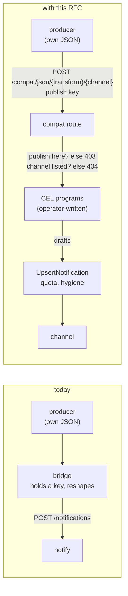
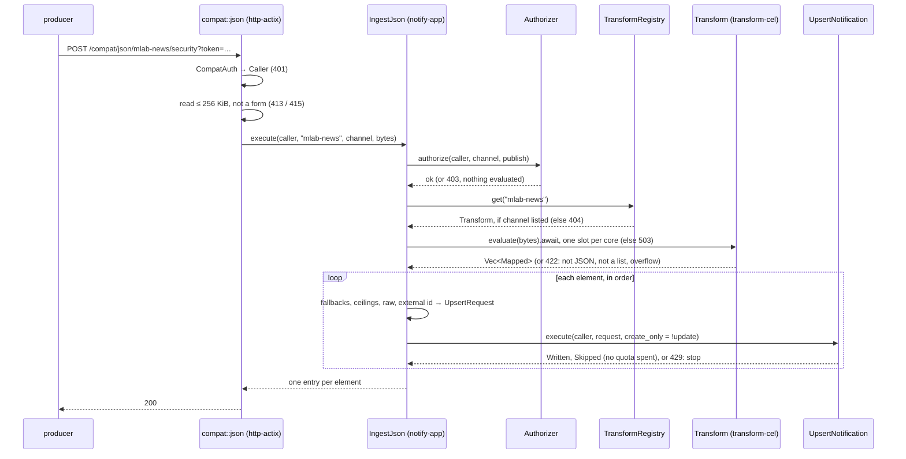
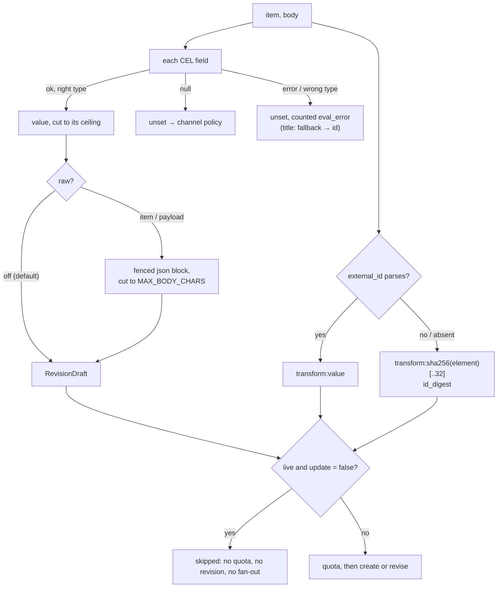
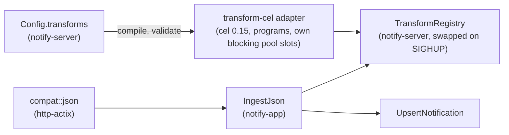
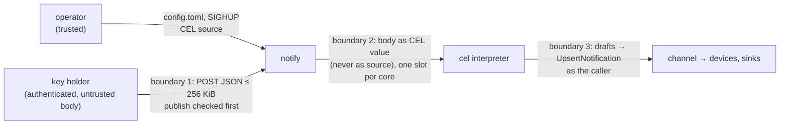

| Field       | Value |
| ----------- | ----- |
| Status      | Implemented (2026-10-28; reviewed by the six-lens panel, decisions 1 to 15 in §15; the delta is §17; the live news.mlab.sh push is still to record) |
| Short       | JSON webhook transforms |
| Settles     | How a producer that only speaks "POST my JSON to a URL" becomes notifications: where the mapping is declared, which language expresses it, how conditions on the body set priority, status and state, which channels may use it, and when the raw body is kept |
| Author      | Max Batleforc &lt;maxleriche.60@gmail.com&gt; |
| Co-author   | Claude Opus 5.5 |
| Created     | 2026-10-27 |
| Supersedes  | — |
| Depends on  | RFC 0004 for closing a notification by hand (§6.P 4 only); everything else stands alone |
| Touches     | `crates/notify-server` (config, `Config::reloaded_from`, validation, wiring, a `transform try` subcommand), `crates/notify-app` (new `IngestJson` use case; `UpsertRequest` gains `create_only`, `UpsertNotification` an `Upserted` outcome), `crates/notify-ports` (new `TransformRegistry` and `Transform` ports, `Metrics` methods), new `crates/notify-adapters/transform-cel`, `crates/notify-adapters/http-actix` (one route and the `read` helper in `routes/compat.rs`, the `PUT` route's prefix check), `crates/notify-adapters/metrics-prometheus`, workspace `Cargo.toml` (`cel`), `fuzz/` (one target), generated spec and HeyApi client, docs |
| Risk        | medium — §7: an authenticated caller's arbitrary JSON is evaluated by operator-written CEL programs on the request path |

<Callout>
  **Reference material.** About 9 000 words: §1 to §4 are the proposal, the
  rest is the design and its proof, read when building or reviewing it.
</Callout>

---

## 1. Summary

Today a producer can publish if it speaks one of four shapes: the native
`POST /notifications`, Gotify, ntfy or Alertmanager
(`crates/notify-adapters/http-actix/src/routes/compat.rs`). Each compat shape
is a hand-written Rust mapping. A service that only lets you paste a URL and
then POSTs *its own* JSON, such as the mlab audit events or news.mlab.sh's push
destinations, can at best land on ntfy's text route as one raw blob titled
with the channel id, and otherwise needs a bridge.

With this RFC the operator declares **transforms** in the config file. A
transform is a set of [CEL](https://cel.dev) expressions, the language
Kubernetes uses for its validation rules: one per notification field, reading
the received JSON as `body` (and the current array element as `item`). CEL has
conditions, `in`, map literals and `matches()`, and no loops, so "a CVE of
severity high stays open at priority high" is one line. An optional `split`
turns an array into one notification per element; `raw` appends the received
JSON to the body, **off by default**. Each transform lists the channels it may
serve. The producer POSTs to `/api/v1/compat/json/{transform}/{channel}` with
an ordinary publish key, and every notification goes through
`UpsertNotification`, so scopes, quotas, hygiene and fan-out are the existing
ones.

### Before / after

```toml
# today: nothing maps a foreign JSON body; a bridge reshapes it and calls
#        POST /api/v1/notifications with a key.

# with this RFC (CEL in TOML literal strings, so backslashes stay as written)
[[transforms]]
id = "mlab-audit"
channels = ["security"]
title = 'body.data.label + ": " + body.data.target'
body = '"`" + body.event + "` · `" + body.data.action + "`"'
external_id = 'body.delivery_id'
tags = '["audit", body.event]'
status = 'body.data.action.endsWith(".deleted") ? "warning" : "info"'
raw = "payload"                      # this one keeps the received JSON

[[transforms]]
id = "mlab-news"
channels = ["security", "veille"]
lang = "fr"
split = 'body.items'                 # one notification per element
title = 'item.title'
body = 'item.source + " · " + item.published_at'
link = 'item.url'
external_id = 'item.id'
group_key = '"mlab-news"'
tags = '["news", item.source]'
priority = '''
  (item.title.matches("CVE-\\d{4}-\\d+") && item.severity in ["high", "critical"])
    ? "high"
    : {"info": "low", "medium": "default", "high": "high", "critical": "urgent"}[item.severity]
'''
status = 'item.severity in ["high", "critical"] ? "warning" : "info"'
state = '''
  (item.title.matches("CVE-\\d{4}-\\d+") && item.severity in ["high", "critical"])
    ? "open" : null
'''
ack = 'item.title.matches("CVE-") ? "Vu" : null'
```

```text
POST /api/v1/compat/json/mlab-audit/security?token=wnk_…
  → 1 notification  "Webhook created: mlab-evt"         status info, raw JSON appended
POST /api/v1/compat/json/mlab-news/security?token=wnk_…
  → 3 notifications "[Virtual Event] What Every…"        priority low,  status info
                    "[Virtual Event] Cybersecurity…"     priority low,  status info
                    "Email Bombing, External Teams…"     priority high, status warning
  a later item "CVE-2026-1234 …", severity high
  → priority high, state open, a "Vu" acknowledgement button; it stays open
    until someone closes it (RFC 0004)
POST /api/v1/compat/json/mlab-audit/veille?token=wnk_…
  → 404, as for a transform that does not exist
```



The new arrow is the producer reaching the server with a body the server did
not design, which then runs through programs on the request path. The body is
untrusted input; the programs come only from the operator's file. §7 bounds
what the first can make the second do, and nothing is evaluated for a caller
who could not publish there.

---

## 2. Motivation

1. **Producers that only push their own JSON need a bridge.** The structured
   ingest shapes are fixed structs (`GotifyBody`, `NtfyBody`,
   `AlertmanagerBody` in `compat.rs`; `RevisionDraft` for the native route),
   and refuse a foreign body with `422 not a valid JSON or form body`. Only
   ntfy's text route (`ntfy_text`, `compat.rs:288`) accepts it, as one opaque
   message titled with the channel id: no title, no severity, one
   notification per POST whatever the body holds.
2. **Each new producer would be a new Rust route.** Alertmanager is 90 lines of
   mapping (`alertmanager()`, `compat.rs:366`) that hard-codes
   `severity=critical` → `Failure`/`Urgent`. Adding the mlab events the same
   way is a release per producer, and the mapping still could not be adjusted
   by the operator who knows what `"high"` means for that source.
3. **What matters is decided by a combination of fields.** A news item of
   severity `high` is worth a look; the same severity on an item that names a
   CVE must stay **open** at priority **high** until someone closes it. No
   route today can derive the lifecycle `state` from the body, and a value
   table keyed on one field cannot express "this field and that pattern".
4. **One body can carry many events.** news.mlab.sh sends one POST with an
   `items` array of three articles of different severities. No route today
   turns one body into several notifications except Alertmanager's
   `alerts`, and only for its own shape.
5. **The bridge is a second process with its own failure modes.** It reshapes
   outside our hygiene and metrics, after a hop nobody monitors. The publish
   key does not go away with this RFC (the producer sends one, and a
   `?token=` URL is then stored at the producer: T13), but the process does.

---

## 3. Goals / non-goals

**Goals**

- An operator declares named transforms in the GitOps config, reloaded on
  `SIGHUP` like sinks and feeds, and only there (decision 2).
- A transform sets title, body, link, tags, group key, external id, priority,
  status, state and an acknowledge button, each from a CEL expression over the
  body, with conditions across fields.
- `split` publishes one notification per element of an array, bounded.
- `raw` appends the received JSON (the item or the whole payload) to the body,
  only when the transform says so.
- A transform serves only the channels it lists; an unlisted pair is
  indistinguishable from an unknown transform (decision 5).
- Given a stable external id, a producer that sends the same element twice, or
  retries a failed delivery, does not create a second notification, does not
  notify again, does not reopen a notification someone closed, and does not
  spend quota on what it already delivered.
- Nothing is evaluated for a caller without `publish` on the channel, no
  program's cost grows faster than the body, and a producer gets an answer
  within a second whatever the program (decisions 9 and 10).
- Every expression compiles and is checked at load, and an operator can try a
  transform on a saved body before any producer calls it.

**Non-goals**

- **Transforms on the API or in the UI.** Editing them would need endpoints,
  spec, a HeyApi client, a Vue editor and an audit vocabulary; config plus
  `SIGHUP` already gives review and history through git (decision 2).
- **Closing the notification.** An `Ack` records a per-user acknowledgement
  and changes nothing else (`Action::Ack`,
  `crates/notify-domain/src/action.rs:78`), and stays so; label it as a
  "seen", not as "close". A person with `publish` or `manage` closes it with
  the web's *Close notification* button, argued in RFC 0004 (decision 7). The
  operator sets `close_after = "0"` on the channel so the server never closes
  it on its own.
- **Free-form comprehensions.** `map`, `filter`, `exists`, `all` and
  `exists_one` are allowed only in a bounded form (decision 9): not nested,
  and their step reads nothing but its own variable and literals, with no
  `matches()`. Anything else is refused at load, because one unbounded
  comprehension is already quadratic (§10.3).
- **Verifying a producer's HMAC signature.** The caller is authenticated by
  its key, as on every compat route. Wanted eventually, as a *bis*
  (decision 4).
- **Dates and time zones.** `cel`'s `chrono` feature stays off;
  `"2026-10-27 20:42:40"` is inserted as text.
- **Routing** ("if `event` is X, publish to channel Y"). The channel is in the
  URL; a producer that needs two channels uses two URLs.
- **Replacing the Alertmanager route with a built-in transform.** It also
  closes notifications on `resolved` and is documented and tested as is.
- **Non-JSON bodies** (forms, XML, plain text that does not parse as JSON).
- **Attachments or images from the body.** An image URL in the JSON would make
  the server fetch it; RFC 0002 kept that surface out for the same reason.

---

## 4. User-facing design

### 4.1 Configuration

Static keys are plain TOML; keys marked *CEL* hold one expression, best
written as a TOML literal string (`'…'`) so that backslashes and double quotes
reach CEL unchanged, or as a multi-line literal (`'''…'''`) when the text holds
an apostrophe (`'''"Acquitter l'alerte"'''`), which a `'…'` string cannot.

```toml
[[transforms]]
id = "mlab-news"              # [a-z0-9-], ≤ 64 chars; the path segment
channels = ["security"]       # required, non-empty: the channels it may serve
lang = "en"                   # "en" (default) or "fr"; server-written strings
split = 'body.items'          # CEL, optional: a list; one notification per element
max_items = 20                # with split: default 20, ceiling 50
title = 'item.title'          # CEL, required: a string
title_fallback = "mlab news"  # when `title` fails or is empty; default: the id
body = 'item.source'          # CEL, optional: a string, Markdown
link = 'item.url'             # CEL, optional: a string, becomes View "Open"
external_id = 'item.id'       # CEL, optional but advised: a string or a number
group_key = '"mlab-news"'     # CEL, optional: a string
tags = '["news"]'             # CEL, optional: a list of strings
priority = '"high"'           # CEL, optional: min | low | default | high | urgent
status = '"info"'             # CEL, optional: success | failure | warning | info | cancelled
state = 'null'                # CEL, optional: open | working | closed
ack = 'null'                  # CEL, optional: a button label, or null for none
update = false                # default false: an element already published is skipped
raw = "off"                   # "off" (default) | "item" | "payload"
```

**Variables.** `body` is the whole decoded payload, always. `item` exists only
with `split`, and is the current element; without `split`, write `body`.
Nothing else is in scope: no environment, no time, no I/O.

- **No `[[transforms]]`** (absent or empty) means the route answers `404` for
  every id, and nothing else changes.
- **`channels` is required** and has no wildcard: a transform with no channel
  listed serves nothing, the closed side (decision 5). It names channel ids,
  so it covers dynamic channels too; since transforms are config-only
  (decision 2), the config is the only place a pair is allowed. A listed id
  that is not a managed channel is accepted (it may be dynamic) and named in
  one `info` line at startup and by `doctor`, so a typo is visible.
- **Unknown keys are refused** inside a transform
  (`#[serde(deny_unknown_fields)]` on `ManagedTransform`, a new struct):
  `raw_body = true` is an error, not a silent `off`. A misspelt table name
  (`[[transform]]`) is not refused, because `Config` keeps tolerating unknown
  top-level keys for rollback's sake (§13); `Config::unhonoured`
  (`config.rs:1236`) reports it at startup instead.
- **`raw` defaults to `"off"`**, the closed side: the received JSON can carry
  identifiers (§9), so keeping it is a decision the operator writes down per
  transform.
- **`update` defaults to `false`**, the quiet side: an element whose external
  id already has a live notification in the channel is skipped, without
  spending quota. A retry, or a producer that sends the same news item in two
  pushes, neither notifies again nor reopens a notification someone closed
  (decision 8).
- **`external_id` absent** is allowed, and then each element is identified by
  a digest of its content (§4.2): one `info` line at startup per such
  transform says so, because a body with a changing field (a delivery id, a
  timestamp) gets a new digest, hence a new notification, on every retry.
- **An optional field whose expression is absent, yields `null`, or fails at
  evaluation** is left unset, so the channel policy (`default_priority`) or
  the domain default (`Info`, no state) applies. A failure is counted, never
  fatal (§4.2).
- **A literal string needs CEL quotes**: `group_key = '"mlab-news"'`. Any
  compile error on a source that holds no quote character carries the hint
  "a literal string needs CEL quotes: `'\"…\"'`".
- A transform is identified by its `id`. Renaming it, or changing its `split`
  or `external_id` expression, changes the external ids it produces (§4.2), so
  the next elements create new notifications instead of being recognised.

### 4.2 Behaviour rules

- **Order of checks** (each answer with its metric outcome, §10.1):
  1. credential (`401`);
  2. body size (`413`, `too_large`) and content type (`415`, `form`): forms and
     multipart are refused, anything else is read as JSON (decision 12);
  3. `publish` on the channel through `Authorizer::authorize` (`403`,
     `forbidden`), as on every write, before anything else is known;
  4. transform known **and** channel listed (`404`, `unlisted` or
     `transform="_unknown"`), one answer for both;
  5. the body parses as JSON (`422`, `not_json`), `split` yields a list (`422`,
     `not_list`), at most `max_items` elements (`422`, `too_many`);
  6. evaluation, then one upsert per element.
- **Selection**: the path names the transform and the channel. The transform
  is never inferred from the body, so the audit producer and the news
  producer can post into the same channel with their own mappings.
- **Allow-list**: the channel must be in the transform's `channels`. Because
  step 3 comes first, only a caller who may publish on the channel learns
  whether a transform serves it (decision 5, decision 10).
- **Elements**: without `split`, the payload is the one element. An empty
  list is `200 []`.
- **Overflow**: a list longer than `max_items` is refused whole with `422`,
  before anything is published (decision 3).
- **Evaluation**: every expression of every element is evaluated before the
  first upsert, so a shape error never leaves half a batch published. The
  payload is converted to a CEL value once per request (1.7 ms for 233 KB in
  the §10.3 probe); each element is evaluated in an inner scope that adds
  `item`.
- **Types**: each field expects the type in §4.1. A result of another type is
  an evaluation failure for that field. JSON numbers arrive as CEL `uint` when
  non-negative and `int` otherwise; comparisons and map keys mix them freely,
  arithmetic does not: `item.count + 1` fails on `uint`, `item.count + 1u` or
  `int(item.count) + 1` works (observed on `cel` 0.15.0, §10.3). A number in a
  string field goes through `string()`.
- **Missing keys**: `item.cve` on an element without `cve` is an evaluation
  failure (`No such key`), so the field is unset. `has(item.cve) ? … : …`
  tests for it, and the docs show it first.
- **Failures are per field**: a failing `title` falls back to
  `title_fallback`, then the transform id, so a title always exists; any other
  failing field is unset. Each failure counts
  `notify_transform_items_total{outcome="eval_error"}`. The **first** failure
  per (transform, field) since the last load is logged at `warn` with the
  transform, the field and the error *kind*; later ones at `debug`. CEL's own
  message is never logged on this path: it quotes body values (§7, T10).
- **Expansion is bounded per field**: each string result is cut at the field's
  ceiling (`MAX_TITLE_CHARS`, the body's share of `MAX_BODY_CHARS`,
  `MAX_GROUP_KEY_CHARS`), at a character boundary, before validation.
- **Title**: the result after `sanitize(…, SingleLine)`. Empty →
  `title_fallback` → the transform id.
- **Body**: Markdown as everywhere (raw HTML is inert, `content.rs:149`).
  Absent, `null` and empty are the same: no body.
- **Raw**: `item` appends the current element, `payload` the whole body,
  pretty-printed in a fenced `json` block after a blank line. The fence is
  one backtick longer than the longest backtick run in the JSON (pretty JSON
  escapes newlines, so this is a second guard, not the only one). When body
  plus raw would exceed `MAX_BODY_CHARS`, the raw block is cut at a character
  boundary, closed, and followed by the truncation marker in `lang`. Raw never
  makes a publish fail. A push carries the body as stored, so the raw block
  also shows in lock-screen previews (§9).
- **Link**: a result that `Action::try_from(ActionDraft::View { … })` refuses
  (not `http(s)`) gives no action, and the item is still published.
- **Ack**: a string result adds `ActionDraft::Ack { label, key: "ack" }` after
  the link, the label cut to `MAX_LABEL_CHARS`. It is a per-user signal;
  closing is RFC 0004's button (decision 7).
- **Tags**: each element sanitised and lowercased by the domain
  (`validate_tags`); empty ones and ones over `MAX_TAG_CHARS` are dropped
  before validation, as `alertmanager()` already does; at most `MAX_TAGS`.
- **Priority, status, state**: the string is matched to the variant
  (`"high"` → `Priority::High`); an unknown string is an evaluation failure.
  A `state` makes the notification a lifecycle one
  (`RevisionDraft::lifecycle` semantics), which the channel's `close_after`
  then ages.
- **External id**: `<transform id>:<result>`. When the expression is absent,
  fails, or the result fails `ExternalId::parse` (too long, control
  characters), the result is replaced by `hex(sha256(element))[..32]`, the
  element serialised by `serde_json` with sorted keys (the workspace does not
  enable `preserve_order`, so `Map` is a `BTreeMap`); counted
  `outcome="id_digest"`. The prefix keeps two transforms that share a channel
  from colliding; the native `PUT` route refuses an external id that starts
  with a declared transform's prefix, so no other publisher can claim one
  (decision 15).
- **Publish path**: one `UpsertNotification::execute` per element, in list
  order, with the caller's own `Caller`, as `alertmanager()` does, and
  `create_only = !update` (§6.2). With `update = false`, an element whose
  external id has a live notification is **skipped before the quota check**
  and reported as skipped (decision 11). With `update = true`, it is revised,
  the new `state` included, so a closed notification can reopen, and a
  producer's retry notifies again: that is what the operator asked for.
- **Not live any more**: `find_by_external_id` only sees live notifications
  (`notifications.rs:88`), so an element whose notification was deleted or
  aged out creates a new one if the producer sends it again.
- **A refused element** (`429` quota) stops the request and returns that
  error; elements already upserted stay, and the producer's retry skips them
  at no quota cost.
- **An element the domain refuses** (`Content::validated` fails although every
  field was cut to its ceiling) is skipped, counted `invalid` and logged at
  `warn`; the others are published. If every element is refused, the answer
  is the first element's `422`.
- **Response**: `200` with one entry per element: the `Published` of a
  written element, or `{ "notification_id": …, "skipped": true }` for a
  skipped one, which carries no content (decision 11).

### 4.3 Validation

Rejected at startup and on `SIGHUP` by `ManagedTransform::validate`
(`crates/notify-server/src/config.rs`), which compiles every expression with
`transform-cel` and walks its AST (`Program::expression`):

| Condition | Rationale |
| --- | --- |
| `id` empty, over 64 chars, outside `[a-z0-9-]`, or declared twice | it is a URL segment, an external-id prefix and a metric label |
| `channels` absent or empty, or an entry that fails `ChannelId::parse` | the closed default must be opened explicitly; a malformed id must not silently allow nothing |
| `title` absent | every notification needs one; a fallback alone would publish identical titles |
| an expression that does not compile | a typo must fail at load, not on every request; the error quotes the expression and the column (`cel`'s own message), plus the quoting hint of §4.1 |
| a free identifier other than `body`, or `item` with `split` | `group_key = "mlab-news"` reads as `mlab - news`; the walk tracks names a comprehension binds, which `Program::references()` would wrongly report as free (`parser/references.rs:113`) |
| `item` used without `split` | it does not exist; write `body` |
| a comprehension (`all`, `exists`, `exists_one`, `map`, `filter`, and the optional macros that expand to one) nested in another, whose step or predicate reads any identifier other than its own loop variable, or that calls `matches()` in its step | a step that rereads the body is quadratic (6.0 s on 233 KB), and `matches()` compiles its regex on every call (1.84 s for 20 000 calls); a step that only reads its own variable is linear (5 to 19 ms on 340 KB, §10.3); decision 9 |
| more than 16 references to `body`/`item` in one expression, or an expression over 4 096 characters | bounds the memory a concatenation can build to 16 × 256 KiB, and keeps compile time trivial |
| `matches()` with a pattern that is not a string literal, or that `regex::Regex::new` refuses | the body must never supply a pattern; a bad pattern fails at load |
| `max_items` = 0 or > 50, or set without `split` | an unbounded fan-out is a flood (§7.5); a useless key is a mistake |
| `raw` not `off`, `item` or `payload`; `item` without `split` | without a split they are the same; one spelling |
| `lang` not `en` or `fr` | the server ships those two catalogues (RFC 0002 decision 14) |
| a string literal that can be the result of `priority`, `status` or `state` (the whole expression, a ternary branch, a map literal's value) and is not a variant | `"hihg"` must not degrade to the channel default |

Warnings, and where the operator sees them:

| Condition | Behaviour | Surfaced in |
| --- | --- | --- |
| an expression fails on an element | field unset, title falls back | `notify_transform_items_total{transform,outcome="eval_error"}`; a `warn` log the first time per (transform, field) since load, `debug` after |
| `external_id` absent, or falling back to the digest | element identified by its content | an `info` line at startup; `outcome="id_digest"` |
| a listed channel that is not a managed channel | allowed (it may be dynamic) | an `info` line at startup and in `doctor` |
| an element the domain refuses | skipped, the others published | `outcome="invalid"`, a `warn` log with transform, channel and element index |
| an element already published (`update = false`) | skipped | `outcome="skipped"`, and `skipped: true` in the response |
| a request for an unlisted channel | `404` | `notify_transform_requests_total{outcome="unlisted"}` and a `warn` log naming the transform and channel (operator-side only) |
| a request refused (not JSON, split not a list, overflow) | `413`/`415`/`422`, nothing published | `notify_transform_requests_total{transform,outcome}`; the producer's own delivery log shows the `Problem` |
| `raw = "payload"` or `"item"` | allowed | one `info` line per such transform at startup |
| the raw block truncated | published with the marker | the notification itself; `outcome="raw_truncated"` |

**Trying a transform.** `notify-server transform try <id> <body.json>`, beside
`doctor`, loads the config without a database and prints, per element, each
mapped field, each failed field with CEL's full message (the operator's own
terminal and file, so T10 does not apply), and the external id
(decision 14). The docs' onboarding is: save one delivery, `try` it, `doctor`,
`SIGHUP`, then point the producer.

### 4.4 API surface

| Method | Path | Auth | Who may call | Limit |
| --- | --- | --- | --- | --- |
| `POST` | `/api/v1/compat/json/{transform}/{channel}` | `CompatAuth`: `Bearer`, `Basic` (password = key), `X-Gotify-Key` or `?token=` | any caller with `publish` on `{channel}`, when `{channel}` is in the transform's `channels` | body ≤ 256 KiB, ≤ `max_items` elements, the caller's and the channel's publish quotas, ≤ one evaluation per core at a time (decision 10) |

The handler is `compat::json` in `routes/compat.rs`, documented with
`#[utoipa::path(tag = "compat")]` like its neighbours; the spec and the HeyApi
client are regenerated in the same phase (`task gen`). Answers, in the order
of §4.2: `401`; `413` over 256 KiB; `415` a form or multipart body; `403` no
`publish` on the channel; `404` unknown transform or channel not in its
`channels`; `422` body not JSON, split not a list, overflow, or every element
refused; `429` quota; `503` with `Retry-After` when every evaluation slot is
busy; `200` with one entry per element.

The limit is 256 KiB, not the 2 MiB `BODY_LIMIT` of the other compat routes:
evaluation cost grows with the body (§7.5), and the two real bodies are 286
and 872 bytes. The `read` helper takes its limit as a parameter; the four
existing callers pass `BODY_LIMIT`, unchanged.

---

## 5. Architecture

### 5.1 One request



This shows that nothing is evaluated for a caller who could not publish on the
channel, that the allow-list is checked before the body is parsed, that every
limit and every expression is evaluated before the first upsert, and that the
only writer is `UpsertNotification` with the producer's own `Caller`.

### 5.2 One element



Every branch ends in a value, "unset" or "skipped"; none ends in an error
except the domain's own validation, the same one `PUT …/notifications/{id}`
applies.

### 5.3 Where it plugs in



The interpreter sits in an adapter behind a port, so `notify-app` never links
`cel` or its ANTLR runtime, the layering RFC 0002 used for feed-rs; like
`avatars` and `attachments-fs`, the adapter offloads its own CPU work, so
`notify-app` gains no `spawn_blocking`. `ApiState` holds use cases, not ports
("so no handler can skip an authorisation check", `state.rs:1`); `IngestJson`
is that use case.

**Invariant**: a transform turns a body into field values and nothing else,
and those values reach the store only through `UpsertNotification` with the
caller's own `Caller`, after `IngestJson` has checked `publish` on the
channel. So a key cannot, through this route, write to a channel, exceed a
quota, publish content it could not write by hand with
`PUT /channels/{id}/notifications/{external_id}`, or make the server evaluate
anything on a channel where it may not publish. The allow-list narrows which
mappings run where. And because the body is only ever a CEL *value*, never CEL
*source*, no body can change what a program does, only what it reads.

---

## 6. Detailed design

### 6.1 `notify-server`

- `Config` gains `pub transforms: Vec<ManagedTransform>` with
  `#[serde(default)]`, beside `service_accounts`. `ManagedTransform` (named
  after `ManagedServiceAccount`) has `deny_unknown_fields`; its CEL keys are
  `Option<String>` holding source. `ManagedTransform::validate` implements
  §4.3 by compiling through `transform-cel`.
- `Config::reloaded_from` (`config.rs:903`) copies only the blocks it names
  and takes the rest from the running config, so it gains
  `transforms: file.transforms`, and its doc comment lists them. Without that
  line a `SIGHUP` would keep the boot-time transforms in silence.
- `TransformRegistry` is implemented here, built in `wiring.rs` and replaced on
  `SIGHUP` the way `SinkRoutes::adopt` (`crates/notify-server/src/sinks.rs:96`)
  swaps sinks. A request in flight keeps the `Arc` it started with.
- `transform try` is a subcommand beside `doctor` (§4.3).
- Transforms are not channel declarations, so the reconciler does not journal
  them. The config file's own history is the record (T7). Replicas adopt a
  `SIGHUP` one by one, and a rolling deploy runs two configs side by side, so
  the ops docs advise adding a transform through a rollout (the Secret
  checksum) and pointing the producer only afterwards; a per-transform
  `notify_transform_info{transform,hash}` gauge makes a split between pods
  visible.

### 6.2 `notify-app`

- `IngestJson::execute(&Caller, &str, ChannelId, Vec<u8>) ->
  Result<Vec<Ingested>, Failure>`, holding `Authorizer`,
  `UpsertNotification`, `Arc<dyn TransformRegistry>` and `Arc<dyn Metrics>`,
  in the order of §4.2. `Ingested` is `Written(Published)` or
  `Skipped(NotificationId)`.
- Pure functions, unit-tested without I/O: `transform_draft(mapped,
  transform)` (fallbacks, ceilings, the ack action), `fence(json)`,
  `external_id(id, mapped)` with the digest fallback, `truncate_raw`.
- `UpsertRequest` gains `create_only: bool`, and `UpsertNotification::execute`
  returns `Upserted::{Written(Published), Skipped(NotificationId)}`. Order
  inside it becomes `authorize`, then (with `create_only`)
  `find_by_external_id`, then `check_quotas`, then write. The skip check runs
  inside the existing retry loop, so a concurrent duplicate that loses the
  insert race (`Conflict`) re-reads and skips rather than revises. The
  existing callers pass `false` and unwrap `Written`: the `PUT` route,
  `alertmanager()`, `PollFeeds` (`crates/notify-app/src/feeds.rs:406`, which
  relies on revising), and the four test literals in `publish.rs` (lines 666,
  755, 771, 794).

### 6.3 `notify-ports`

- `Transform`: `channels()`, `update()`, `raw()`, `lang()`, and
  `async evaluate(Vec<u8>) -> Result<Vec<Mapped>, TransformError>`. `Mapped`
  is port-owned: `title: Option<String>`, `body`, `link`, `external_id`,
  `group_key`, `ack` as `Option<String>`, `tags: Vec<String>`, `priority`,
  `status`, `state` as `Option` of the domain enums, the element as
  `serde_json::Value`, the payload as one shared `Arc<serde_json::Value>`, and
  the list of fields that failed with their kinds. `cel` types never cross
  the port.
- `TransformRegistry::get(&self, id: &str) -> Option<Arc<dyn Transform>>`, with
  a `StaticTransforms` test double whose `Transform` is a closure, for the
  `notify-app` tests.
- `Metrics` gains `transform_request(id, outcome)`,
  `transform_items(id, outcome, n)` and `transform_eval_seconds(id, s)`, with
  no-op defaults, implemented in `metrics-prometheus`.
- The digest uses `sha2`, already a `notify-ports` dependency
  (`FingerprintKey`, `sinks.rs:66`).

### 6.4 `transform-cel` (new adapter)

- `cel = { version = "0.15.0", default-features = false, features = ["regex"] }`:
  no `chrono`/`chrono-tz`, no `json` (which only adds CEL-to-JSON,
  `src/json.rs`; JSON goes in through `impl<T: Serialize> TryIntoValue`,
  `objects.rs:544`).
- `CelTransform::compile(spec) -> Result<Self, CompileError>`: one
  `Arc<Env::stdlib()>`, one `Program` per field, then one AST walk over
  `Program::expression()` that implements every structural row of §4.3
  (comprehension shape, free identifiers with bound names tracked,
  reference count, literal `matches` patterns, result literals).
- `evaluate`: takes a slot of a `Semaphore` sized to the number of cores
  (`try_acquire`; none free → `TransformError::Busy`, answered `503` with
  `Retry-After: 1`), then on `tokio::task::spawn_blocking`, awaited for at
  most `EVAL_TIMEOUT` (1 s; past it, `TransformError::Timeout`, answered
  `503`, nothing published):
  `serde_json::from_slice` (recursion limit 128), one `Context::with_env`
  holding `body`, the `split` program, the `max_items` check, and per element
  `new_inner_scope()` (`context.rs:375`) adding `item`, then each program. An
  `ExecutionError` is mapped to a fixed kind (`no_such_key`, `type`,
  `overload`, `other`); its `Display` text is dropped, because variants such
  as `UnsupportedTargetType { target: Value }` print body values. A blocking
  task cannot be killed, so a timed-out evaluation runs to its end: the slot
  is held until then, client gone or not, so the cap on cores holds, and the
  timeout only bounds the producer's wait. The load-time rules of §4.3 are
  what bound the work itself.

### 6.5 `http-actix`

- `compat::json` reuses `CompatAuth` and `read(payload, JSON_BODY_LIMIT)` with
  `JSON_BODY_LIMIT` = 256 KiB. It refuses `application/x-www-form-urlencoded`
  and `multipart/form-data` with `415` and reads anything else as JSON
  (decision 12).
- It is registered after `compat::alertmanager` in `routes/mod.rs:119`;
  `state.metrics.published` is called per element written, as the other
  compat routes do.
- The native `PUT /channels/{channel}/notifications/{external_id}` refuses an
  external id that starts with `<declared transform id>:` (decision 15).
- The `?token=` query is already stripped from notify's own access log
  (`crates/notify-server/src/main.rs:278`) and from the `Referer`
  (`routes/mod.rs:47`); an ingress or proxy in front logs it by default, which
  the ops docs say next to the URL form.

### 6.P Proof against a real client

The consumers are the two real producers, replayed by `curl` 8.x against a
dev instance (`task dev`), with their bodies byte-for-byte as received on
2026-10-27 (in the author's request; saved as
`crates/notify-adapters/http-actix/tests/fixtures/mlab-audit.json` and
`mlab-news.json`). The same observations run in
`crates/notify-adapters/http-actix/tests/api.rs`, beside the existing
Alertmanager test, with the `InMemory` store and the real `transform-cel`
adapter. Plus one manual observation: the news.mlab.sh "test push" pointed at
the dev instance, recorded at landing.

Already observed, on 2026-10-27 and 2026-10-28, with two scratch crates on
`cel` 0.15.0 (release build) outside the repository; phase 1 turns them into
`transform-cel`'s unit tests. Running the exact §1 expressions (with `"Vu"`
then labelled `"Acquitter"`) over the two real bodies: `Webhook created:
mlab-evt`, status `info` and tags `audit`, `audit.webhooks` for the audit
event; priorities `low`, `low`, `high`, statuses `info`, `info`, `warning`,
state and ack `null` for the three news items; priority `high`, status
`warning`, state `open` and an ack label for a synthetic `CVE-2026-1234 …`
item of severity `high`. Also: `No such key` for a missing field and for a map
without the key; `body.headline` read from inside an item; `mlab-news`
unquoted compiling to the variables `mlab` and `news`; a compile error with
its column for `item.severity ==`.

That producer's delivery settings (headers, `Content-Type`, signature,
retries) were **not** verified: its site is a client-rendered page and the
probe (`curl -sI https://news.mlab.sh`, `200`, `text/html`, behind Cloudflare)
says nothing about them (decision 12).

1. **Audit event**: `curl -H 'Content-Type: application/json' --data
   @mlab-audit.json '…/compat/json/mlab-audit/security?token=$KEY'` → `200`
   with one written entry; title `Webhook created: mlab-evt`, status `info`,
   tags `audit`, `audit.webhooks`; `external_id`
   `mlab-audit:35d9f387-e22b-4174-99ef-e42abdf95f2a`; the body ends with a
   fenced block containing `"delivery_id"`.
2. **Retry is silent and free**: the same command again → `200` with
   `skipped: true` and the same notification id, still `seq` 1, no new outbox
   row, and the rate-limit counter unchanged.
3. **Fan-out and conditions**: `mlab-news.json` → three notifications in list
   order; the third has priority `high`, status `warning` and one `View`
   action to its `url`; the first two priority `low`; no state; no `Ack`; no
   body contains `"published_at"`, because `raw` is `off`.
4. **CVE stays open** (needs RFC 0004 for its last step): the news fixture with
   a fourth item titled `CVE-2026-1234 …`, severity `high` → state `open`,
   priority `high`, an `Ack` action; in a channel with `close_after = "0"`,
   `CloseStale` does not close it; after closing it with RFC 0004's button,
   the same body again leaves it `closed` (`update = false`).
5. **Shared channel**: both bodies posted into `security` → four
   notifications, none revising another (distinct prefixes).
6. **Refusal, credential**: no token → `401`, no transform lookup, no row.
7. **Refusal, scope**: a key with `publish` on another channel only, posting
   to `mlab-news/security` and to `mlab-news/nope` → `403` for both, and the
   evaluation counter does not move.
8. **Refusal, shape**: `{"items": {"a": 1}}` to `mlab-news` → `422`
   "split is not a list"; 51 items with `max_items = 50` → `422` before any
   upsert; a form body → `415`; 300 KiB → `413`.
9. **Refusal, unknown transform**: `…/compat/json/nope/security` with a valid
   key → `404`, identical for every unknown id.
10. **Refusal, unlisted channel**: `…/compat/json/mlab-audit/veille` with a key
    holding `publish` on `veille` → `404`, byte-for-byte the answer of
    observation 9, and the store's write count stays 0.
11. **Fence escape**: an audit body whose `label` holds three backticks, a
    newline and `# injected` → the rendered body has one code block, and the
    heading is inside it.
12. **Refusal, squatting**: `PUT /channels/security/notifications/mlab-news:x`
    with a publish key → `422`, nothing written.

**Deliberately untouched**, so reviewers do not go looking:

- `compat::alertmanager`, `gotify`, `ntfy*` and `decode` keep their behaviour
  and tests (non-goal); Alertmanager passes `create_only = false` and unwraps
  `Written`.
- `crates/notify-domain` is not changed: `Action::Ack` is used as it is, and
  closing by hand is RFC 0004.
- `crates/notify-adapters/sinks-webhook` is *outbound* delivery and shares
  nothing with this inbound route.
- `web/` gains no screen; the generated client gains one function nobody in
  the UI calls.
- The reconciler and its journal (§6.1).

---

## 7. Security

**Rating:** medium. No new trust is granted (the caller is an authenticated
publisher, as on every compat route), but a body the server did not design is
now evaluated by programs on the request path, by a new third-party
interpreter that has no cost budget of its own, and the received JSON can be
republished verbatim to every device and sink of a channel.

### 7.1 Threat model

Assets: the instance's availability (CPU and memory) on the request path, the
channels' content and the people who read it, quota fairness between
publishers, and whatever the producer's JSON carries (§9). Actors: the
**producer**, holding a publish key, possibly compromised or simply verbose;
anyone who **obtains a key**, including one without rights on the target
channel; another **publisher** on the same channel; the **operator**, trusted,
who writes the transforms.



| # | Threat (STRIDE) | Where | Mitigation | Residual risk |
| --- | --- | --- | --- | --- |
| T1 | Elevation: publishing where the key could not | 1, 3 | `IngestJson` calls `Authorizer::authorize(…, Publish)` first; `UpsertNotification` authorises again per element | none |
| T2 | DoS: deep or large JSON | 1 | `JSON_BODY_LIMIT` 256 KiB via `to_bytes_limited`; `serde_json`'s recursion limit (`remaining_depth: 128`, `de.rs:63` in the locked 1.0.154) | one parse of ≤ 256 KiB per request; none |
| T3 | DoS / tampering: fan-out flood | 1, 3 | `max_items` ≤ 50, checked before the first upsert; channel and per-principal quotas per written element | ≤ 50 upserts per request, within quota; accepted |
| T4 | DoS: a program whose time or memory grows faster than the body | 2 | comprehensions only in the bounded form of §4.3 (decision 9); ≤ 16 body references per expression; body ≤ 256 KiB; evaluation only after `publish` is checked; ≤ one evaluation per core, `503` past that; `EVAL_TIMEOUT` 1 s on the wait | each program is linear in what it reads; a timed-out evaluation keeps its core until it ends; worst accepted request measured in phase 2 (§10.3); accepted by the author (decision 9) |
| T5 | DoS: regular-expression blow-up | 2 | patterns are string literals checked at load; `regex` has no backtracking (linear in the input); 2 MB matched in 18 ms in the probe | none |
| T6 | Tampering: the body steering a program | 2 | the body is bound only as a value (`Context::add_variable`); it is never compiled, never a pattern, never a variable name | none |
| T7 | Repudiation: who changed a mapping | config | transforms live only in the config file, under git (decision 2); each revision carries the publishing principal as `Author` | no server-side journal of transform edits; accepted |
| T8 | Info disclosure: the raw body (identifiers, internal hostnames) republished to devices, lock screens and sinks | 3 | `raw` off by default; on only per transform, written by the operator, with a boot-time `info` line | an operator who turns it on accepts it; documented in §9 |
| T9 | Info disclosure / elevation: brute-forcing transform ids, or using a mapping on a channel it was not written for | 1 | `publish` checked before anything (`403` alike for missing and forbidden channels, `authz.rs:153`); then the `channels` allow-list, required, no wildcard, `404` identical for an unknown id and an unlisted channel, before the body is parsed | a key holder learns which transforms serve the channels where it may publish anyway; accepted |
| T10 | Info disclosure: body values in logs, errors or metric labels | logs | CEL error text dropped, only a fixed kind kept (§6.4); logs carry transform, field, channel and element index; labels are the transform id (operator-declared, unknown ids folded into `_unknown`) and a fixed `outcome` set; the `422` names the field, not the value | the external id, a body value the operator chose as identity, appears in the `upsert` span (`publish.rs:421`) as for every upsert; accepted, §9 |
| T11 | Tampering: reopening or re-notifying a notification by replaying a body | 1, 3 | `update = false` by default: an existing external id is skipped, no revision, no fan-out, no quota | with `update = true`, a key holder can reopen; the operator chose it |
| T12 | Elevation: a bug in the interpreter or its ANTLR parser | 2 | the parser only ever reads operator source, at load; the request path only converts JSON to CEL values and evaluates; fuzz target over evaluation; `task audit`; the security review's probe found errors, not panics, on overflow, `i64::MIN / -1`, out-of-range indexes, `int(1e308)`, 120-deep arrays and NUL/RLO strings | an interpreter bug reachable through values; tracked by `cargo audit` |
| T13 | Info disclosure: the publish key, as a `?token=` URL, stored in the producer's settings and in proxy logs | 1 | one service account per producer, `publish` only on its channels, rotated by the existing key endpoints; header forms preferred where the producer allows one | a leaked key publishes into those channels until revoked; accepted, documented |
| T14 | Spoofing / tampering: another publisher claims an external id first and silences the real alert (`update = false` skips it) | 3 | the native `PUT` refuses ids with a declared `<transform>:` prefix (decision 15); inside the route, ids are always prefixed by the transform | a publisher using the same transform on the same channel can still pre-empt; it holds that channel's `publish` and its writes carry its name |
| T15 | Info disclosure: reading a notification through the skip | 3 | a skipped element answers its id and `skipped: true`, no content (decision 11) | the key learns that an external id exists in a channel where it may publish; accepted |

### 7.2 Authentication and authorisation

- The route is authenticated by `CompatAuth`, the extractor every compat route
  uses; there is no anonymous path. A missing or wrong key is `401` before the
  body is read.
- `publish` on the channel is checked by `IngestJson` before the transform is
  looked up or the body parsed, so a key without rights there costs one
  authorisation and learns nothing about transforms (T1, T9).
- The allow-list then decides which transforms run on which channel
  (decision 5).
- `create_only`'s lookup happens after `authorize` and before `check_quotas`:
  it reveals nothing to a key that may not publish, and costs no quota
  (T11, T15).
- `?token=` is accepted, as on the other compat routes, because URL-only
  producers have no other way (T13).

### 7.3 Input handling and injection

- Body: anything but a form, `serde_json::from_slice` into `Value`, then bound
  as CEL values; nothing is deserialised into a typed struct.
- CEL source comes only from the config file. The body never becomes source, a
  pattern, a URL fetched by the server, a path, SQL or a header (T6).
- Every result passes the domain's existing hygiene (`sanitize`, `TextKind`,
  length checks, `validate_tags`, `ExternalId::parse`, `Action::try_from`).
  The transform only adds the ceilings and the fence; the web renders
  Markdown with HTML off, sanitised, and `http(s)`-only links
  (`web/src/lib/markdown.ts`).
- The external id is the program's result, prefixed, or a digest; the
  prefixes are reserved against the native route (T14).

### 7.4 Secrets and cryptography

- No new secret. The producer's key is an existing API key, hashed at rest as
  today (T13).
- `sha256` is used for identity (a stable external id), not secrecy, through
  `sha2`, already a `notify-ports` dependency.
- A producer's own HMAC signature is not checked in v1 (decision 4).

### 7.5 Abuse and resource exhaustion

- Per request: ≤ 256 KiB read, one parse, one conversion to a CEL value,
  ≤ 50 elements, ≤ 10 programs per element plus `split` once, each ≤ 4 096
  characters with ≤ 16 body references and only bounded comprehensions,
  ≤ 50 upserts
  each counted against the quotas, skipped elements free.
- Concurrency: at most one evaluation per core; the rest get `503` and
  `Retry-After: 1` rather than a queue. A producer waits at most 1 s for an
  evaluation. A dropped or timed-out request does not cancel a running
  evaluation, but it keeps its slot, so the cap holds.
- Measured costs and what they bound are in §10.3. Nothing is evaluated before
  `publish` is checked, so only a key with rights on the channel spends CPU,
  and the quota limits how often it can write.
- No outbound request is made.

### 7.6 Existing defences that still hold

- `CompatAuth` and the publish/upsert authorisation, unchanged.
- Channel `publish_per_min` and the per-principal quota
  (`persistence-pg/src/quota.rs`).
- The domain limits in `crates/notify-domain/src/limits.rs`.
- Query-string stripping in notify's access log and the `no-referrer` policy.

---

## 8. Supply chain

Resolved in a scratch crate on 2026-10-28 with
`cel = { version = "=0.15.0", default-features = false, features = ["regex"] }`
and compared with the workspace `Cargo.lock`: seven crates are new, every
other one (`nom` 7.1.3, `regex` 1.13.1, `serde_json` 1.0.154, `thiserror`,
`lazy_static`) is already locked at the same version. `cargo audit` on that
scratch lockfile (RustSec database of 2026-10-28, 1 380 advisories) exits 0.
Run on the workspace at phase 1 (2026-10-28): `task audit:cargo` green; the tree
adds nine crates, not seven (§17.4).

| Dependency | Version | Why this one | Licence | Known CVEs (`cargo audit`) | Maintenance |
| --- | --- | --- | --- | --- | --- |
| `cel` | 0.15.0, MSRV 1.86 (workspace: 1.94) | a non-Turing-complete expression language with a spec and a conformance suite; the alternative is a home-made language (§12) | MIT | none | released 2026-10-06; about 4.3 M recent downloads; `cel-rust/cel-rust` organisation; used by `kube-cel` |
| `antlr4rust` (transitive) | 0.6.0 | `cel`'s parser runtime; reached only at load | BSD-3-Clause | none | released 2026-09-27 |
| `borsh`, `borsh-derive` (transitive) | 1.8.1 | pulled in by `antlr4rust` | MIT OR Apache-2.0 | none | released 2026-08-26, widely used |
| `murmur3` (transitive) | 0.4.1, as `antlr4rust` requires | pulled in by `antlr4rust` | MIT/Apache-2.0 | none | the crate's latest is 0.5.2, released 2022-10-10: small and quiet; watched by `cargo audit` |
| `pastey` (transitive, proc-macro) | 0.2.3 | `cel`'s macros | MIT OR Apache-2.0 | none | released 2026-05-20 |
| `typed-arena` (transitive) | 2.0.2 | pulled in by `antlr4rust` | MIT | none | last release 2023-01-09, stable |

Every licence is already in `deny.toml`'s `allow` list (MIT, Apache-2.0,
BSD-3-Clause); no new git or registry source.

- **Build and release**: Containerfile and CI unchanged. The SBOM gains the
  seven crates.
- **Updates**: Dependabot and `task deps`, like every Rust crate. A `cel`
  minor bump is reviewed against the §14 security tests, since its evaluator
  is on the request path.

---

## 9. Data and privacy

| Data | Personal? | Where stored | Retention | Who can read it | Leaves the instance? |
| --- | --- | --- | --- | --- | --- |
| mapped fields (title, body, tags, link) | whatever the operator chose to map; the examples map labels, sources and titles, no person | as any notification | channel TTL, from closing for a lifecycle notification | channel subscribers | through the channel's push and sinks, as today |
| raw block (`raw = "item"`/`"payload"`) | possibly: the audit example carries `actor_uuid` and `org_uuid`, pseudonymous identifiers of a person and an organisation | the notification body | as above | channel subscribers, and every push provider and sink the channel uses; shown in lock-screen previews | yes, as the body does |
| external id | no in the examples (a producer id or a digest), but it is whatever the operator chose | `notifications.external_id`, and the `upsert` tracing span | as the notification; the operator's trace retention | channel members through the API; operators | to the trace backend, as every upsert's |
| logs and metrics | no: transform id, channel id, field name, element index, error kind, outcome | logs, Prometheus | the operator's log retention | operators | per the operator's log shipping |

- The default (`raw = "off"`) stores nothing the operator did not name in an
  expression: minimisation by construction. An operator should not pick a
  personal field as `external_id`, since it lands in traces; the docs say so.
- With `raw` on, a person's pseudonymous id can end up in a push payload, on
  a lock screen, and in an outbound email or webhook. The ops docs say so
  next to the option, and recommend `item` over `payload` and an expression
  over either.
- A notification left `open` with `close_after = "0"` is never aged out: its
  retention starts when someone closes it (RFC 0004).
- Erasure: a notification and its revisions are deleted by the existing
  delete path or by TTL; nothing is copied elsewhere.
- The request body itself is not stored or logged; only what the transform
  produces is.

---

## 10. Operability

### 10.1 Observability

- **Metrics** (prefix `notify_`, labels bounded: `transform` is an
  operator-declared id, `outcome` a fixed set):
  - `notify_transform_requests_total{transform,outcome}`, `outcome` ∈ `ok`,
    `too_large`, `form`, `forbidden`, `unlisted`, `not_json`, `not_list`,
    `too_many`, `busy`, `timeout`, `refused` (quota mid-way), `all_invalid`. Requests
    whose transform is unknown count under `transform="_unknown"` with
    `outcome="unlisted"`, so a probe cannot create series. A rise of
    `unlisted` is someone probing a channel they may publish to.
  - `notify_transform_items_total{transform,outcome}`, `outcome` ∈
    `published`, `skipped`, `invalid`, `eval_error`, `id_digest`,
    `raw_truncated`.
  - `notify_transform_eval_seconds{transform}`, a histogram of one request's
    evaluation, including the wait for a slot.
  - `notify_transform_info{transform,hash}`, `1` per loaded transform, so
    replicas on different configs show (§6.1). A removed transform's series
    stay exported until the next restart, as other per-id series do.
  - `notifications_published_total{channel}` still moves per element written.
- **Logs**: `warn` the first evaluation failure per (transform, field) since
  load, `debug` after; `warn` per skipped invalid element, per refused request
  and per `unlisted` request (transform, channel, index, the `DomainError`
  field name), never a body value; `info` at boot per transform with `raw` on,
  without `external_id`, or listing a channel that is not managed.
- **Audit**: no new event. Published notifications carry the producer's
  principal as `Author`; transform edits are config commits (T7).
- **Alerts**: none paged. The ops docs suggest ticket-level rules on
  `rate(notify_transform_requests_total{outcome!="ok"}[1h]) > 0` (a producer
  changed its format), on `outcome="busy"`, and on the p99 of
  `notify_transform_eval_seconds` above 0.1 s.

### 10.2 Failure modes

| Failure | Detected by | Behaviour (fail open / closed) | Recovery |
| --- | --- | --- | --- |
| producer changes its JSON shape | `not_list`, `eval_error` (logged once at `warn`), titles falling back | split mismatch: closed (`422`, nothing published); missing fields: published with fallbacks and unset fields | fix the transform, `try` it, `SIGHUP` |
| a field missing on some elements | `eval_error` | that field unset; title falls back | guard with `has()` |
| quota reached mid-request | `refused`, the producer sees `429` | elements before it stay; the rest are not published | the producer's retry skips the first ones at no quota cost and continues (with `update = true` it revises them, re-notifying) |
| every evaluation slot busy | `busy`, the producer sees `503` | nothing evaluated (closed) | the producer retries after `Retry-After` |
| bad transform on `SIGHUP` | the reload error | reload refused, running set kept (closed) | fix and `SIGHUP` again |
| transform removed, or channel unlisted, while a producer still calls it | `_unknown`, `unlisted` | `404` (closed); producers usually drop a `4xx` delivery | restore it or repoint the producer |
| replicas on different configs during a rollout | `notify_transform_info` | a new transform answers `404` on pods that lack it | add transforms by rollout, point producers after (§6.1) |
| a slow transform | `notify_transform_eval_seconds`, `outcome="timeout"` | the producer gets `503` after 1 s, nothing published (closed); the evaluation keeps its core until it ends, so others get `503` sooner | simplify the expression |
| a concurrent duplicate request | — | the insert race's loser re-reads and skips | none needed |
| Postgres down | the publish path's own errors | `5xx`; the producer retries per its own policy | automatic |

Refusals are **closed** (`4xx`/`503`, nothing published) and so is every
config error. Missing values degrade to fallbacks on purpose: a notification
with a fallback title is more useful than a producer stuck retrying a `422`
forever.

### 10.3 Performance and capacity

Measured on 2026-10-27 and 2026-10-28 with the scratch crates, `cel` 0.15.0,
release build, on the author's workstation:

| Case | Input | Time |
| --- | --- | --- |
| field reads and a ternary (the §1 expressions) | the two real bodies (286 and 872 bytes) | not measurable next to the rest |
| converting the body to a CEL value | 40 000 integers, 233 KB of JSON | 1.7 ms |
| one `map` comprehension, completing (`x + 1u`) | same | 7.7 ms |
| one `filter` whose step tests `x in body.items` | same | **6.0 s** (quadratic: refused, decision 9) |
| one `map` whose step concatenates a 4 KB string twice | same | 260 ms and about 320 MB built |
| a `map` whose step concatenates its own variable 8 times | 20 000 strings, 340 KB | 18.7 ms (bounded form) |
| `exists(x, x == "nope")`, `map(x, x.size())` | same | 5.6 ms, 4.8 ms (bounded form) |
| a `filter` whose step calls `x.matches(…)` | same | **1.84 s**: the regex is compiled on every call (refused in a step, decision 9) |
| `matches("(a\|b)*c")` once | a 2 MB string | 18 ms |
| nested `map` inside `map` | 2 000 × 2 000 | 1.03 s |
| a `map` whose step is `x + x` (2026-10-28, in the tree) | 12 000 to 48 000 two-letter strings, up to 240 KB; and 3 to 926 strings of 256 B to 64 KiB | 8 to 31 ms, doubling with the count; under 1 ms when the strings are long and few |
| a `map` whose step is `x + x + …` with 256 terms, accepted before §17.1 row 18 | 3 strings of 64 KiB | **1.63 s**: each `+` recopies the string built so far |
| `1u + 1u + …` 1 000 terms deep, accepted before §17.1 row 18 | any body | **stack overflow, the process aborts** (a debug build already at about 60 levels on a 2 MiB thread) |
| depth by shape, straight through `cel` on a 2 MiB thread (2026-10-28) | `+`, nested ternaries, calls, lists, maps, `!`, `&&`, selects, chained `map`/`filter`/`exists`, flat `a ? b : c ? …` | release: no overflow up to 512 levels for any shape but `+` (between 512 and 1 000); the parser refuses past 96 nested brackets or ternaries with an error. Debug: the **parser** overflows at about 12 nested brackets, ternaries or calls, `+` and chained comprehensions evaluate up to 48 and overflow at 64; `&&` builds a balanced tree and stays shallow |
| `map(x, x)`, `filter(x, x == 0u)`, `exists(x, x == 1u)` (2026-10-28, in the tree) | 10 000 to 120 000 integers, 20 to 240 KB | 3 ms to 33–40 ms each, doubling with the list: linear, the accumulator is not copied per step |

- In the bounded form, a program's cost is the size of what it touches:
  ≤ 16 references, each at most the 256 KiB body, so a concatenation builds
  at most 4 MiB, an `in` scans at most one list, and a comprehension's step
  sees one element at a time.
  The worst accepted request was measured at phase 2: 50 elements, 7 programs
  each scanning a 25 000-string list 16 times (`"absent" in body.l`, joined by
  `||` so none short-circuits), over a 226 KB body: **about 0.7 s** in a release
  build, under the 1 s a producer waits but with little margin (§17.1 row 6).
- Memory: the parsed `Value` and its one CEL copy (each about the body's size
  times a small factor), and at most 50 drafts of ≤ 64 KiB
  (`MAX_PAYLOAD_BYTES`); times the number of slots at worst.
- Storage: one notification per new element; a retried body writes nothing
  and spends no quota (`update = false`).
- Latency: dominated by the sequential upserts, as on the Alertmanager route.

---

## 11. Other concerns

- **Accessibility**: no UI. Notifications render in the existing views; a raw
  block is a code block and an `Ack` a button, which they already render.
- **Internationalisation**: the server-written strings are the `Open` label of
  the link action and the truncation marker. Both are stored in the
  notification, so the per-transform `lang` (`en` by default, or `fr`) picks
  them from RFC 0002's two-entry catalogue in `notify-app` (decision 6). The
  `ack` label is the operator's own text; the docs advise a "seen" wording,
  since an acknowledgement does not close anything. Mapped text is in the
  producer's language.
- **Compliance**: the CRA SBOM gains seven crates (§8). No other control
  changes.
- **Licensing**: MIT, Apache-2.0 and BSD-3-Clause dependencies, all already
  allowed; BSD-3-Clause asks for its notice in binary distributions, which the
  SBOM and the existing licence report carry.
- **Documentation**: `docs/content/docs/clients/compat.mdx` gains an "Any JSON
  webhook" section with the two examples, the onboarding loop of §4.3 (`try`,
  `doctor`, `SIGHUP`), CEL's traps (quoting literals, apostrophes in TOML
  literal strings, `uint` versus `int`, `has()` for optional fields), why a
  re-sent test body shows nothing new (`skipped`), the `raw` privacy note and
  the CVE example with `close_after = "0"` and RFC 0004's button; the ops
  config reference gains `[[transforms]]`, the §4.3 errors, the metrics and
  the rollout advice of §6.1; the API reference is regenerated.

---

## 12. Alternatives considered

| Alternative | Why rejected |
| --- | --- |
| Do nothing: point producers at ntfy's text route (`/compat/ntfy/{channel}`) | works today with no code, but each POST becomes one notification titled with the channel id and holding the raw JSON as its message: no title, no severity, no state, no split |
| Do nothing: run a bridge per producer | a second process outside our hygiene and metrics, per producer (§2.5) |
| A hand-written route per producer, like Alertmanager | a release per producer, and the mapping (what `"high"` means) is fixed in Rust instead of chosen by the operator |
| JSON Pointer templates plus value tables (the first draft) | no dependency, but a value table keys on one field: "CVE in the title **and** severity high → open" cannot be written; rejected by the author (decision 1) |
| JSON Pointer plus home-made `when`/`set` rules | covers conditions, but it is a language of our own to specify, document, fuzz and keep growing, where CEL already has a spec and a conformance suite |
| jq through `jaq` 3.x | jq programs can loop (`repeat`, `until`, recursion), and jaq offers no step budget; three crates |
| JMESPath (`jmespath` 0.5) | no conditional expression to produce `"open"` or nothing |
| CEL with free comprehensions and a step budget | `cel` 0.15 has no budget hook; adding one means forking the evaluator |
| CEL with comprehensions and only a timeout (the author's first choice for decision 9) | a blocking task cannot be killed: the CPU keeps running past the timeout, and memory is not bounded at all (320 MB measured, about 7 GB at 256 KiB by the security review's estimate), so the process can be OOM-killed |
| No comprehension at all (the panel's recommendation) | safe, but loses `exists`/`filter` over an element's own lists, which the bounded form keeps at linear cost |
| Bind transforms on `[[channels.managed]]` instead of channels on the transform | dynamic channels have no config block, so they could never use a transform |
| No allow-list at all | any key could probe every transform on every channel it holds; rejected by the author (decision 5) |
| Always append the raw body | publishes identifiers to devices and sinks by default (§9); the author asked for it "only if I want it" |
| Revise on every repeat (`update = true` as default) | a retried or re-sent CVE would notify again and reopen what someone closed (T11) |

---

## 13. Rollout and compatibility

- **Default behaviour**: no `[[transforms]]` → the new route answers `404`;
  nothing else changes. Existing compat routes are untouched; existing
  `UpsertRequest` callers pass `create_only = false` and get `Written`.
- **API compatibility**: `Published` is unchanged, so the Alertmanager and
  `PUT` responses and their generated clients stay the same; the new route has
  its own response type. The `PUT` route newly refuses external ids carrying
  a declared transform's prefix (decision 15); with no transforms declared,
  it refuses nothing new.
- **Migration**: none. No schema change; old configs parse unchanged
  (`#[serde(default)]`).
- **Operator prerequisites**: a publish key for each producer (a
  service account with `publish` on the target channels is the documented
  way), the producer's URL setting pointed at
  `/api/v1/compat/json/{transform}/{channel}`, and `close_after = "0"` on a
  channel whose open notifications must wait for a person.
- **Rollback**: `helm rollback` to the previous image. It still loads a
  config that declares `[[transforms]]`, because `Config` does not deny
  unknown fields (`#[serde(default)]` only, no `deny_unknown_fields` in
  `config.rs`). Producers then get `404` from the older router, and
  notifications already published stay. Nothing closed in §7 reopens.
- **Feature flag**: the config itself.

---

## 14. Test plan

- **Unit** (`crates/notify-adapters/transform-cel`): compile errors with and
  without the quoting hint, unknown free identifiers, `item` without `split`,
  bounded comprehensions accepted (one whose loop variable is the only
  identifier, which `references()` would misreport as free) and every other
  shape refused, the 17th body reference
  refused, non-literal and invalid `matches` patterns refused, result-literal
  typos refused in a ternary branch and a map value; evaluation of the §1
  expressions over both fixtures; each field with the wrong type, `null`, a
  missing key and a `uint + int`, each giving unset and the right error kind;
  split not a list; `max_items` + 1; the body converted once per request;
  `Busy` when every slot is taken.
- **Unit** (`crates/notify-app`): `transform_draft` fallbacks and ceilings at a
  character boundary; `external_id` from a result, too long → digest, absent
  → digest stable across key order (`{"a":1,"b":2}` and `{"b":2,"a":1}` give
  one id); `fence` with no backtick, a run of three and a run of ten; raw
  truncation keeps the block closed and uses `lang`; the ack action;
  `IngestJson` order: `403` before lookup, `404` before evaluation.
- **Unit** (`crates/notify-app/src/publish.rs`): `create_only` on a hit returns
  `Skipped` with the limiter's count unchanged and no revision or outbox row;
  on a miss it creates; a lost insert race with `create_only` skips; the
  existing tests, with the new field set to `false`.
- **Unit** (`crates/notify-server/src/config.rs`): one test per §4.3 row; an
  unknown key in a `[[transforms]]` table refused; `[[transform]]` reported
  by `unhonoured`; a `SIGHUP` that edits a transform is adopted, and one with
  a bad transform is refused with the running set kept.
- **Integration** (`crates/notify-adapters/http-actix/tests/api.rs`): §6.P 1
  to 12 with the two fixtures; a quota of 2 with three news items → two
  published, `429`, and the retry after the window skips the first two at no
  cost and publishes the third.
- **Security**, one per T-row:
  - T1: §6.P 7.
  - T2: a 256 KiB + 1 body → `413`; a 200-deep nested array → `422`.
  - T3: §6.P 8 (51 items) and a 30 000-element array within 256 KiB refused
    before any upsert (store write count 0).
  - T4: `body.l.filter(x, x in body.l)`, a `map` concatenating body strings,
    a nested comprehension and `filter(x, x.matches(…))` refused at load;
    `item.labels.filter(x, x.startsWith("cve"))` accepted; the worst accepted
    request of §10.3 under 1 s; with every slot held, the next request gets
    `503` without evaluating; an evaluation past 1 s answers `503` and keeps
    its slot until it ends.
  - T5: a `matches(item.pattern)` refused at load; a literal pattern over a
    200 KiB string stays under 10 ms.
  - T6: a body whose values are CEL source (`"body.x"`, `"1 + 1"`) comes out
    as those strings.
  - T7: none testable in code; the ops docs state the git-history control.
  - T8: `raw = "off"` → no body contains any key of the input.
  - T9: §6.P 7, 9 and 10: unauthenticated → `401`; no `publish` → `403` on a
    listed and an unlisted pair alike, with the evaluation counter still;
    the two `404`s equal byte for byte; a malformed body to an unlisted pair
    is not parsed (`not_json` does not move).
  - T10: logs captured during §6.P 1 to 12, and during a `uint + int` and a
    `No such key` failure on a body value `secret-8124fd73`, contain none of
    the fixtures' values nor that string, outside the `external_id` span
    field; the `422` body neither.
  - T11: §6.P 2 and 4; with `update = true` the same replay revises and
    reopens.
  - T12: `fuzz/fuzz_targets/fuzz_transform.rs` over JSON bytes evaluated by a
    fixed set of transforms (the §1 ones) never panics.
  - T13: none testable in code; the ops docs state the per-producer key.
  - T14: §6.P 12.
  - T15: a skipped element's response entry holds no title, body or revision.
- **Proof**: §6.P.
- **Audit**: `task audit` green with `cel` and its six transitive crates.
- **Existing suites** that must pass, with only the new `create_only` field
  added where `UpsertRequest` is built: the compat tests in `tests/api.rs`
  (Gotify, ntfy, Alertmanager), the `notify-app` publish, upsert and feed
  tests, and the `CloseStale` tests.

---

## 15. Decisions and open questions

### Resolved

| # | Question | Decision |
| --- | --- | --- |
| 1 | Which expression language? | **CEL, through the `cel` crate 0.15 in its own adapter, with `chrono` off.** The draft recommended JSON Pointer templates with value tables; the author rejected them because a mapping must combine fields ("a CVE of severity high stays open at priority high"). CEL has conditions and no loops (decided with the author, 2026-10-27). |
| 2 | Config only, or also the API and UI? | **Config only, no dynamic transforms.** Reviewed in git, no endpoint, spec or screen to secure (decided with the author, 2026-10-27). |
| 3 | What happens past `max_items`? | **Refuse the whole request with `422`, nothing published.** A producer's batch size is known when the transform is written, and `max_items` goes up to 50 (decided with the author, 2026-10-27). |
| 4 | Verify the producer's signature? | **Yes eventually, not in v1**: a later *bis* adds `signature = { header, secret_ref, scheme }` per transform on the `hmac`/`sha2` already locked. Whether the mlab producers sign is still unverified (decided with the author, 2026-10-27). |
| 5 | Should a transform be restricted to some channels? | **Yes: a required `channels` list per transform, no wildcard**, an unlisted pair answering the same `404` as an unknown id. This goes against the draft's recommendation (no restriction): it narrows what a leaked key can brute-force (decided with the author, 2026-10-27). |
| 6 | Which language for the server-written strings? | **A per-transform `lang`, `en` by default, or `fr`**, from RFC 0002's catalogue (decided with the author, 2026-10-27). |
| 7 | How does a notification stay open until someone deals with it? (raised by the author) | **The transform sets `state` (and, if wanted, an `Ack` button as a per-user signal); a person closes it with RFC 0004's *Close notification* button**, open to `publish` and `manage`. `close_after = "0"` on the channel keeps it open until then (decided with the author, 2026-10-27; the button chosen over an `Ack` that closes on 2026-10-28). |
| 8 | What does a repeated element do? (follows from 7) | **Nothing, by default (`update = false`)**: an external id that already has a live notification is skipped after authorisation, so a retry or a re-sent CVE neither notifies again nor reopens a closed one. `update = true` revises. Without it, decision 7 would be undone by the producer's next push. |
| 9 | Comprehensions: refuse them, or bound them? (panel, 2026-10-28) | **Allowed in a bounded form, plus a 1 s timeout on the wait**: not nested; the step reads only its own variable and literals, never `body`, `item` or `matches()`; ≤ 16 body references per expression. The panel found one unbounded comprehension quadratic (6.0 s, 320 MB on 233 KB) and recommended refusing them all; the author first chose a timeout alone, which cannot stop a blocking task or bound its memory, then this form, linear by construction (5 to 19 ms on 340 KB) and measured again in phase 2 (decided with the author, 2026-10-28). |
| 10 | Authorise before evaluating, and cap concurrency? (panel) | **`publish` on the channel first, then the allow-list, then evaluation on one slot per core, `503` with `Retry-After` past that.** A key without rights costs one authorisation (decided with the author, 2026-10-28). |
| 11 | What does a skip cost and answer? (panel) | **Skip before `check_quotas`, after `authorize`; `Upserted::Skipped`; the response entry is `{notification_id, skipped: true}`, no content.** A retry costs no quota, and a publish-only key reads nothing (decided with the author, 2026-10-28). |
| 12 | Which `Content-Type`? (panel) | **Refuse forms and multipart, read anything else as JSON.** The mlab producers' header is unverified, and is recorded at landing (decided with the author, 2026-10-28). |
| 13 | Require `external_id` when `update = false`? (panel) | **Optional**, with an `info` line at startup, the `id_digest` counter and documented examples that always set it (decided with the author, 2026-10-28). |
| 14 | A `transform try` command? (panel) | **Yes, in phase 3**, beside `doctor`, printing CEL's full messages on the operator's own terminal (decided with the author, 2026-10-28). |
| 15 | Reserve the transform prefixes? (panel) | **The native `PUT` refuses an external id starting with a declared `<transform id>:`.** A publisher using the same transform on the same channel can still pre-empt, under its own name (decided with the author, 2026-10-28). |

### Still open

None.

---

## 16. Implementation phases

| Phase | Content |
| --- | --- |
| 1 | `transform-cel` adapter: compile, the §4.3 AST checks (comprehension shape, free identifiers, reference count, literal patterns and results), evaluation with error kinds, the slot semaphore and `EVAL_TIMEOUT`, its unit tests and the `fuzz_transform` target; `Transform`/`TransformRegistry` ports with `Mapped`; `cel` in the workspace; `task audit` on the workspace green and §8 updated. No caller yet, tree green. |
| 2 | `UpsertRequest::create_only` and `Upserted`, with the quota order of decision 11 and every existing caller updated; `Metrics` methods; `IngestJson` with tests against `StaticTransforms`; `compat::json` with its utoipa path, `JSON_BODY_LIMIT`, the `read` parameter, the `PUT` prefix check, wired in `ApiState` with an empty registry (every request `404`); spec and HeyApi client regenerated; the integration and security tests of §14 that need no config, including the T4 timing. Every §7 control lands here, with the route, and the route is unreachable until phase 3 declares a transform. |
| 3 | Config (`ManagedTransform` with `channels`, `lang`, `update`, §4.3 validation, `reloaded_from`, `unhonoured`), the registry built from it and swapped on `SIGHUP`, `transform try` (decision 14), Prometheus metrics; §6.P 1 to 12. Usable from this phase. |
| 4 | Docs (`clients/compat.mdx`, ops config reference, metrics, rollout advice, the `raw` privacy note, the CVE example); the live news.mlab.sh test push recorded with its `Content-Type`; status moved to `Implemented` with §17. |

---

## 17. Revision against the tree (2026-10-28)

All four phases shipped on `feat/rfc-0003-json-transforms`, branched from
`feat/rfc-0002-feeds`. This section records where the tree differs from the text
above and what the proof observed; the earlier sections are left as reviewed.

### 17.1 Where the tree differs, and why

| # | The RFC says | The tree does | Why |
| --- | --- | --- | --- |
| 1 | `UpsertRequest` gains `create_only`, `execute` returns `Upserted` (§6.2) | `UpsertRequest` is unchanged; `UpsertNotification::create_or_skip` returns `Upserted`, and `execute` still returns `Published` | The four existing callers (the `PUT` route, Alertmanager, `PollFeeds`) and the test literals stay as they were. Both share one loop, with the skip read before the quota as decision 11 asks |
| 2 | `Upserted::Written(Published)` | `Upserted::Written(Box<Published>)` | `Published` is about 1 KB and the other variant 16 bytes (clippy `large_enum_variant`) |
| 3 | `cel` without the `json` feature (§6.4) | `features = ["regex", "json"]` | A `split` element comes back from CEL as a CEL value; `json` turns it into JSON for the digest and the raw block. Its crates (`serde_json`, `base64`) were already locked |
| 4 | `notify_transform_*` metric names (§10.1) | `transform_requests_total`, `transform_items_total`, `transform_eval_seconds`, `transform_info` | No family carries a prefix, as RFC 0002 §17.1 row 2 found for feeds |
| 5 | Request outcomes (§10.1) | adds `internal` (the interpreter panicked, caught by `spawn_blocking`, answered `500`) and `error` (the store failed mid-way) | A closed set needs a label for every way a request ends |
| 6 | Worst accepted request under 1 s (§10.3) | about 0.7 s in release; the test is `#[ignore]`d in debug builds, where it times out | The 16-reference rule counts `item` too, so "16 `in body.list` tests" per program cannot load; the test uses 16 scans with a literal left side. The margin is thin: a body crafted near that bound evaluates for most of a second, and past one second the caller gets `503` while the core stays busy |
| 7 | The first evaluation failure per (transform, field) **since the last load** is a `warn` | since the process started | `shortcut:` in `ingest.rs`; clear the set on `SIGHUP` if operators miss the warn of an edited transform |
| 8 | The boot `info` lines (raw on, no `external_id`, unmanaged channel) | are `doctor` notes, which the startup log prints at `info` | One list for both, as §4.3's "Surfaced in" column already pairs them |
| 9 | `lang` from RFC 0002's catalogue | the transform reuses `FeedLang` and the feed's `open_label`; the truncation marker is `_(truncated)_` / `_(tronqué)_` | One catalogue |
| 10 | The fixtures are the bodies "byte-for-byte as received" (§6.P) | `tests/fixtures/mlab-audit.json` and `mlab-news.json` are **reconstructed** from the fields this RFC quotes | The received bodies were never committed; replace both files with the real deliveries when they are at hand |
| 11 | `transform try` prints the external id | it prints `<id>:<result>`, or the digest when the program gives none | It does not show the digest fallback for a result `ExternalId` refuses (too long); the route does apply it |
| 12 | The native `PUT` refuses a reserved prefix (decision 15) | it refuses it only after checking `publish` on the channel; without it, the answer is the usual `403` | Refusing first told any key which transform ids exist (code review, 2026-10-28), which the route's single `404` hides (T9) |
| 13 | §4.3 has no reserved id | `id = "feed"` is refused at load | `feed:` is the external-id namespace of RFC 0002's feeds; a transform of that name could revise or silence a feed's notification in a shared channel |
| 14 | `notify_transform_info` set per transform | the whole series is replaced once a set is adopted, at boot and after a `SIGHUP` that built | Set per transform, an edited one kept its old hash at `1`, a removed one stayed "loaded", and a `SIGHUP` that failed had already published the set it threw away |
| 15 | The raw block is cut to fit `MAX_BODY_CHARS` | the mapped body is cut too when it alone fills the room left by the fences and the marker | A body already at the ceiling made the whole exceed it, so the element was refused as `invalid` on every request |
| 16 | One `UpsertNotification::execute` per element (§4.2) | `publish` is checked once per request; each element goes through `UpsertNotification::upsert_in`, the same loop on the channel already authorised, which refuses a channel authorised for another id | Re-authorising per element read the channel and its memberships 50 more times in a 50-element request (code review, 2026-10-28) |
| 18 | ≤ 16 references to `body`/`item` per expression (§4.3, decision 9) | the 16 count reads of a comprehension's own variables too (not the macro's `@result`), and an expression may not nest deeper than 32 levels (`MAX_DEPTH`) | Measured while checking the code review's point 10: a step `x + x + …` with 256 terms took 1.63 s on three 64 KiB strings, the terms being free under the old count; and 1 000 chained `1u +` loaded and then overflowed the evaluating thread's stack, aborting the process on the first request. Both are now refused at load. The source's bracket nesting is also capped at 32 before the parser runs, since in a debug build the parser overflows an 8 MiB stack (the main thread that compiles at boot and on `SIGHUP`) at about 60 nested brackets. Brackets inside string literals do not count; the scanner follows `cel`'s literal grammar, checked against its parser: escapes, triple quotes that end only at three quotes, and raw literals (`r"…"`, `br"…"`, any case, `b` first) where a backslash escapes nothing |
| 17 | `TransformRegistry::ids()` lists the reserved prefixes (§6.3) | no `ids()`: the prefix before the first `:` is looked up with `get` | One map lookup per `PUT` instead of copying every id; an id never holds a `:` |

### 17.2 Proof

`crates/notify-adapters/http-actix/tests/api.rs`, against the in-memory store and
the real `transform-cel` adapter:

| §6.P | Test | Observed |
| --- | --- | --- |
| 1, 2 | `a_json_webhook_is_mapped_and_its_retry_is_silent` | title, status, tags, prefixed external id, fenced raw block; the retry answers `[{notification_id, skipped: true}]` and the notification stays at `last_seq` 1 |
| 3, 4, 5 | `a_json_webhook_splits_and_decides_by_conditions` | three notifications, the third `high`/`warning` with one `View`; no state; no raw; a CVE of severity high is `lifecycle`, `open`, `high`, with an `ack` after the link; both producers share the channel |
| 6–10 | `a_json_webhook_refuses_before_evaluating` | `401`; `403` for a listed pair, an unlisted one and an unknown id alike; the unknown-id and unlisted `404` bodies equal byte for byte, the latter with a non-JSON body; `422` not a list, `422` for 51 items, `415` form, `413` over 256 KiB, `422` 200-deep array; nothing written |
| 11 | `a_backtick_run_in_the_body_cannot_close_the_raw_block` | a label holding three backticks and a heading gets a four-backtick fence |
| 12 | `the_native_upsert_may_not_claim_a_transforms_prefix` | `PUT …/mlab-news:x` → `422`, nothing written |

`notify-server transform try` was run over the news fixture with a failing `body`
expression: three elements, each with `! body: No such key: cve`.

Not done: the last step of §6.P 4 (closing with RFC 0004's button, and
`CloseStale` leaving an open notification in a `close_after = "0"` channel); the
quota-of-2 integration test of §14 (covered at the use-case level by
`a_repeated_element_is_skipped_without_spending_quota` and
`a_create_only_upsert_skips_a_live_external_id_without_spending_quota`); and the
live news.mlab.sh test push with its `Content-Type` (decision 12).

### 17.3 Threat rows against their tests

| # | Proved by | Gap |
| --- | --- | --- |
| T1 | `publish_is_checked_before_anything_is_evaluated`; §6.P 7 | — |
| T2 | §6.P 8 (`413`, 200-deep array `422`); `shapes_that_cannot_be_split_are_refused_whole` | — |
| T3 | §6.P 8 (51 items, nothing written) | the 30 000-element array is refused by the same `max_items` check, not tested separately |
| T4 | `only_bounded_comprehensions_load`, `the_seventeenth_body_reference_is_refused`, `with_every_slot_taken_the_next_request_is_busy_without_evaluating`, `the_worst_accepted_request_evaluates_within_the_deadline` (release), `a_bounded_comprehension_is_linear_in_its_list` (release: 120 000 elements under 250 ms, 4× the elements under 8× the time; refutes the code review's quadratic-accumulator concern), `a_string_step_is_linear_in_its_list` (release), `a_step_may_not_read_its_variable_more_than_sixteen_times`, `an_expression_deeper_than_the_limit_is_refused_and_the_limit_evaluates` (the deepest expression that loads evaluates through `evaluate` on tokio's blocking pool, debug build included), `the_deepest_accepted_expression_of_every_shape_evaluates` (for `+`, ternaries, calls, lists, maps, `&&` and chained comprehensions: compiled on an 8 MiB thread, evaluated on the blocking pool, debug and release), `brackets_inside_a_literal_do_not_count_as_nesting` | no test of an evaluation past 1 s keeping its slot: nothing that loads runs that long in a test |
| T5 | `matches_needs_a_literal_pattern_that_compiles` | the 200 KiB literal-pattern timing is not asserted |
| T6 | `a_body_made_of_cel_source_stays_text` | — |
| T7, T13 | ops docs | none testable in code |
| T8 | §6.P 3 (`raw = "off"`: no body holds `published_at`) | — |
| T9 | §6.P 7, 9, 10; `an_unknown_transform_and_an_unlisted_channel_are_one_404_before_evaluation` | — |
| T10 | `a_failing_field_is_unset_with_a_kind_that_quotes_nothing` (kinds only, on a body value `secret-8124fd73`) | logs are not captured and searched |
| T11 | §6.P 2; `a_repeated_element_is_skipped_without_spending_quota` | the `update = true` replay that reopens is not tested |
| T12 | `fuzz_transform`, run 60 s on 2026-10-28: 2 193 651 runs, no crash | — |
| T14 | §6.P 12; `the_reserved_prefixes_are_the_declared_ids_and_a_colon` | — |
| T15 | §6.P 2 (the skipped entry is `{notification_id, skipped}` only) | — |

### 17.4 Supply chain as shipped

`cel` 0.15.0 with `regex` and `json`, bringing `antlr4rust` 0.6.0, `borsh` and
`borsh-derive` 1.8.1, `murmur3` 0.4.1, `pastey` 0.2.3, `typed-arena` 2.0.2, and
`bit-set` 0.11.1 / `bit-vec` 0.10.1 beside the 0.5.3 / 0.6.3 already locked, which
the scratch resolution of §8 did not list. `task audit:cargo` is green: `cargo
audit` finds no advisory and `cargo deny` accepts every licence and source (the
new duplicates are warnings, as the existing ones are). The `json` feature's
`base64` resolves to a version already locked.
