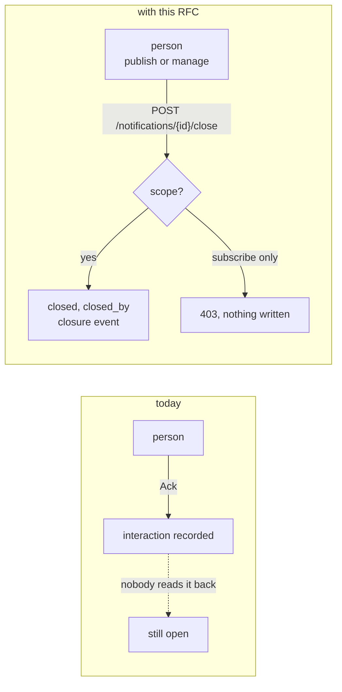
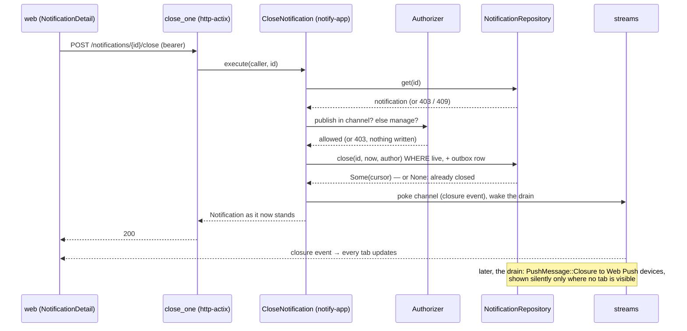
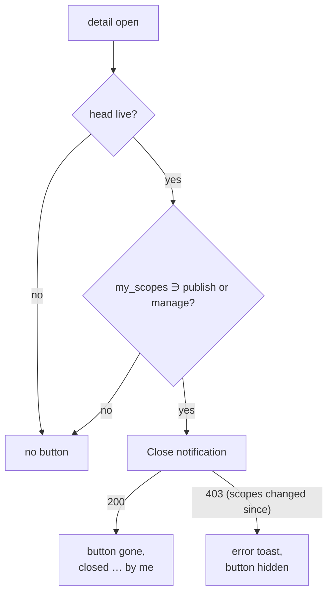
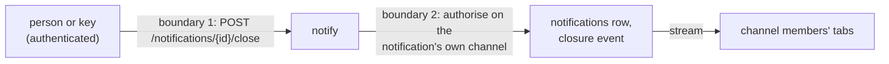

| Field       | Value |
| ----------- | ----- |
| Status      | Implemented (2026-10-28; decisions 1 to 4 in §15, no panel run; the delta is §17; §6.P 3 and 4 still to observe) |
| Short       | Close from the web |
| Settles     | Who may close a lifecycle notification by hand, through which endpoint, how it is recorded and announced, and how the web shows the button only to them |
| Author      | Max Batleforc &lt;maxleriche.60@gmail.com&gt; |
| Co-author   | Claude Opus 5.5 |
| Created     | 2026-10-28 |
| Supersedes  | — |
| Touches     | `crates/notify-domain` (`Notification::close`, `closed_by`), `crates/notify-ports` (`NotificationRepository::close`, `EventPayload::Closure`, `PushMessage::Closure`, one `Metrics` method, `InMemory`), `crates/notify-app/src/fanout.rs` (the closure push), `crates/notify-adapters/push-webpush` (`Envelope::Closure`), `crates/notify-app` (new `CloseNotification`, `Authorizer::scopes_in`, `ListChannels` view), `crates/notify-adapters/persistence-pg` (one migration, `close`), `crates/notify-adapters/http-actix` (one route, `GET /channels` item shape), `web/` (detail and inbox stores, `NotificationDetail.vue`, `AppLayout.vue`, `public/sw.js`, `en.json`, `fr.json`), generated spec and HeyApi client, docs |
| Risk        | low — §7: a new write, gated by scopes that already allow stronger writes, except `manage`, which gains this one |

---

## 1. Summary

A lifecycle notification (one published with a `state`) stays `open` until its
publisher revises it to `closed`, or until the channel's `close_after` passes
(`CloseStale`, `crates/notify-app/src/closure.rs`). The `Ack` button does not
close it: it records a per-user acknowledgement that the publisher is meant to
read back (`Action::Ack`, `crates/notify-domain/src/action.rs:78`;
`docs/architecture/domain-model.mdx`, "Interactions"). A webhook producer, such
as those of RFC 0003, never reads it back, so a CVE published `open` stays open
for ever on a channel with `close_after = "0"`, and nobody in the web can do
anything about it.

With this RFC, the notification detail gains a **Close notification** button
for whoever holds `publish` or `manage` in the channel. It calls
`POST /api/v1/notifications/{id}/close`, which closes the notification the way
`CloseStale` does (no revision, a `closure` event), and records who closed it.
Every open tab updates live. A browser where nobody is looking gets a silent
Web Push that replaces the alert on its lock screen with "closed by Alice",
without buzzing.

### Before / after

```text
# today
publisher  ── PUT …/notifications/{external_id} {"state":"closed"} ──▶ closed
CloseStale ── after close_after of inactivity ──────────────────────▶ closed
a person   ── clicks "Ack" ──▶ an interaction; the notification stays open

# with this RFC
a person with publish or manage
           ── clicks "Close notification" ──▶ POST /notifications/{id}/close
           ──▶ closed, closed_by = that person, a closure event to every tab
```



The new arrow is a person writing to a notification they did not publish; the
request a subscriber sends is the one refused.

---

## 2. Motivation

1. **A notification nobody publishes back can never be closed by a person.**
   The only writers of `state` are `UpsertNotification`/`PublishNotification`
   (a publisher) and `CloseStale` (the clock). `RecordInteraction`, behind the
   `Ack` button, writes an interaction and pokes the streams
   (`crates/notify-app/src/interact.rs`); nothing in it touches the head. The
   CVE flow of RFC 0003 (decision 7) needs a person to end it.
2. **Closing by API needs the external id and a publish key.** `PUT
   /channels/{channel}/notifications/{external_id}` is the only way to close
   by hand today. A notification published by `POST /notifications` has no
   external id at all, and a person in the web holds a session, not a key.
3. **The web does not even show server closures.** The stream's `closure`
   event exists (`EventPayload::Closure`, `crates/notify-ports/src/event.rs:167`;
   `event: 'closure'` in `web/src/api/generated/types.gen.ts:856`), but neither
   store handles it: `web/src/stores/inbox.ts:309` switches on `revision` and
   `tombstone`, `web/src/stores/detail.ts:245` on `revision`, `interaction`,
   `receipt` and `tombstone`. A notification `CloseStale` closed stays `open`
   on screen until a reload.
4. **The web cannot tell which buttons a person may use.** `GET /channels`
   returns each channel's `members` and `group_access`
   (`types.gen.ts:277`), but the caller's own scopes depend on their
   identity-provider groups, which the server resolves (`Authorizer::authorize`,
   `crates/notify-app/src/authz.rs:143`). A button shown to everyone would
   answer `403` to most of them.

---

## 3. Goals / non-goals

**Goals**

- A person with `publish` or `manage` in a channel closes one of its live
  notifications from the web, in one click.
- The closure records who did it, and the detail shows it ("closed … by
  Alice").
- Every client on the stream sees the closure without a reload, whoever closed
  it: a person, a publisher's revision, or `CloseStale`.
- Closing never buzzes and never re-delivers to a sink. A browser with no
  visible tab has its lock-screen alert replaced in place; a visible tab
  takes the update from the stream and shows nothing more.
- The button is shown only to people who may use it.
- Closing an already closed notification is a no-op that succeeds.

**Non-goals**

- **Making `Ack` close.** `Ack` stays a per-user acknowledgement that a
  publisher reads back; closing is a separate, scoped act (decided with the
  author, 2026-10-28, against an `Ack { closes = true }` option).
- **Reopening from the web.** A publisher reopens by revising with a live
  `state`, as today. A reopen button would need its own answer to "who may
  undo whose close".
- **Changing `status` on close** (marking it `success` or `cancelled`). The
  status says what the notification reports; a person closing it says they
  dealt with it. A *bis* can add an optional body if that proves wrong.
- **Bulk close** (select many, close all). One button per notification in v1.
- **Native clients** (`notify-client-core`, the Tauri shells' cache, the CLI
  TUI, APNs and UnifiedPush devices). None handles `closure` today either;
  they keep showing a closed notification open until their next sync, and
  receive no closure push, since they would not know its kind. They get their
  own change.
- **Telling sinks.** A server closure is not delivered to sinks today, and a
  manual one follows it. A webhook sink that must learn of closures is a
  sinks change, not a button.

---

## 4. User-facing design

### 4.1 Configuration

No configuration. The feature is on for every channel, because the right to
use it is the channel's existing scopes: `publish` and `manage`. A channel that
wants nobody to close by hand grants neither to people, which is already how a
GitOps channel restricts publishing.

- A subscriber (`subscribe` alone) sees no button and is refused by the
  endpoint: the closed side for the large majority of members.
- `close_after` keeps working as today; a manual close only ends a
  notification earlier.

### 4.2 Behaviour rules

- **Who**: the caller must hold `publish` **or** `manage` in the
  notification's channel, resolved by the authoriser exactly as for other
  writes (memberships, groups, API-key and federated grants).
- **What**: only a live notification (`State::Open` or `State::Working`)
  changes. An already closed one, including a fire-and-forget notification
  born closed, answers `200` with the notification as it stands and writes
  nothing (no event, no `closed_by` change).
- **Effect**: `state = closed`, `closed_at = now`, `closed_by = the caller's
  Author`, retention starting now, exactly as `Notification::close` already
  does for `CloseStale` (`crates/notify-domain/src/notification.rs:395`), plus
  `closed_by`. No revision is written: the head's title, body and actions stay
  as the publisher wrote them, `View` link and `Ack` included.
- **Announcement**: one `closure` event in the channel, carrying `closed_at`
  and now `closed_by`; streams are poked as for interactions. No sink
  delivery.
- **Closure push** (decision 3): the close also records one fan-out outbox row
  in the same transaction, as a revision does (ADR-0025). The drain sends
  `PushMessage::Closure` to the channel's **Web Push** devices only, the
  closer's own included, at priority `min` (`Urgency: very-low`), after the
  usual silence and do-not-disturb filter; a closure held back by a quiet
  period is dropped, never counted into the digest. The service worker hands
  it to a visible tab first (`handedToAVisibleTab`, `web/public/sw.js:201`),
  which acknowledges without a toast because the stream already updated it;
  with no visible tab it calls `showNotification` with the same tag
  `notification:{id}` and `renotify: false`, so the alert already on the lock
  screen is replaced by the title and "Closed by Alice", silently. That is
  "those who are not on the tab".
- **Reopened later**: a publisher's revision with a live `state` reopens it as
  today; `Notification::revise` clears `closed_at`
  (`notification.rs:340`) and now `closed_by` with it.
- **Gone**: a deleted or expired notification answers `409`
  (`notification.gone`), as `GET /notifications/{id}` does.
- **Race with a publisher**: the store closes only if the row is still live
  (`UPDATE … WHERE state IN ('open', 'working')`); whichever write lands last
  wins, as between two publisher revisions today.
- **Web, the button**: in the detail header, labelled *Close notification* /
  *Clore la notification*, shown when the head is live **and** the channel's
  `my_scopes` contains `publish` or `manage`. The panel's own *Close* /
  *Fermer* button (`notification.detail.close`) keeps its label, so the two
  never share an accessible name. While the request runs the button is
  disabled and spins; on success it disappears and the meta line reads
  `· closed {at} by {name}`.
- **Web, the event**: both stores handle `closure`: the inbox row and the
  detail switch to `closed`, set `closed_at`, and `closed_by` when present.
  This is what makes server closures visible too.

### 4.3 Validation

Refused on input:

| Condition | Answer | Rationale |
| --- | --- | --- |
| no credential | `401` | as every route |
| `{id}` not a notification id | `422` | as `GET /notifications/{id}` |
| unknown id, or a channel the caller cannot see | `403` | `GetNotification` answers missing and forbidden alike; this route does the same so an id cannot be probed |
| `subscribe` only | `403` | the closed side; a reader acknowledges, a writer closes |
| deleted or expired | `409 notification.gone` | as reading it |

Warnings: none. A refused close is answered to the person who clicked, in a
toast from the web's existing toast store (`web/src/stores/toasts.ts`); it does not deserve an
operator's attention.

### 4.4 API surface

| Method | Path | Auth | Who may call | Limit |
| --- | --- | --- | --- | --- |
| `POST` | `/api/v1/notifications/{id}/close` | `Authenticated` (bearer: session, API key, federated token) | `publish` or `manage` in its channel | idempotent; at most one write per live-to-closed transition |
| `GET` | `/api/v1/channels` (changed) | unchanged | unchanged | each item gains `my_scopes: Scope[]`, the caller's own |

`notifications::close_one` (new) and `channels::list_channels` (changed) carry
`#[utoipa::path]` like their neighbours; the spec and the HeyApi client are
regenerated (`task gen`). `my_scopes` is additive: an older client ignores it.

---

## 5. Architecture

### 5.1 One close



This shows that the authorisation runs on the notification's own channel
before anything is written, and that the side effects are one row update, one
event and one outbox row, in one transaction: no revision, no sink delivery,
and a push that never buzzes.

### 5.2 Which button, for whom



The button is a convenience the server does not trust: a stale `my_scopes`
only shows a button that is then refused.

**Invariant**: closing is strictly weaker than deleting, which `publish`
already grants (`DeleteNotification`, `crates/notify-app/src/read.rs:291`), and
weaker than revising, which `publish` grants too. So a `publish` holder gains
no power it did not have. `manage` gains exactly one write, closing, because a
channel's administrator is the person a channel's readers turn to when
something is left open.

---

## 6. Detailed design

### 6.1 `notify-domain`

- `Notification` gains `closed_by: Option<Author>`, serialised only when
  present.
- `Notification::close(at)` becomes `close(at, by: Option<Author>)`;
  `CloseStale` passes `None`. `revise` clears `closed_by` wherever it clears
  `closed_at`.

### 6.2 `notify-ports`

- `NotificationRepository::close(id, at, by: &Author) ->
  PortResult<Option<Cursor>>`: sets `state`, `closed_at`, `closed_by` and
  `expires_at` on a live row and appends the closure event in one
  transaction; `None` if the row was not live. Same shape as `mark_deleted`
  (`notifications.rs:148`). `InMemory` implements it.
- `EventPayload::Closure` gains `closed_by: Option<Author>` with
  `#[serde(default, skip_serializing_if = "Option::is_none")]`, so a server
  closure serialises exactly as today.
- `PushMessage::Closure { channel, notification_id, closed_by: Option<String> }`
  (the closer's display name, or reference when none), whose `priority()` is
  `Priority::Min`; `as_poke` keeps it as is, since it carries no content.
- `AfterWrite` gains `closure: bool`, recorded on the outbox row (one
  boolean column), so the drain sends a closure rather than the notification.
- `Metrics` gains `notification_closed(reason)`,
  `notify_notifications_closed_total{reason}` with `reason` ∈ `manual`,
  `stale`, no-op by default; `CloseStale` reports `stale`, since no counter of
  its closures exists today (`ClosureReport` only reaches the log).

### 6.3 `notify-app`

- `CloseNotification::execute(&Caller, NotificationId) ->
  Result<Notification, Failure>`, beside `DeleteNotification` in `read.rs`:
  `get`, gone check, `authorize(…, Scope::Publish)` falling back to
  `Scope::Manage`, `close` with `AfterWrite { closure: true, .. }`,
  `poke_channel` and `wake`.
- `Fanout`: for a `closure` row, `delivery_targets` filtered to
  `PushTransport::WebPush`, the usual `stays_quiet` filter without a digest
  entry, then `PushMessage::Closure`. The author is built by the
  existing `Attribution`, as revisions are.
- `Authorizer::scopes_in(caller, &Channel) -> Vec<Scope>`: the three
  `allows` checks the authoriser already makes, gathered.
- `ListChannels` returns `ChannelView { #[serde(flatten)] channel, my_scopes }`.

### 6.4 `persistence-pg`

Migration `20261028000000_closed_by.sql`:

```sql
ALTER TABLE notifications ADD COLUMN closed_by JSONB;  -- the closer, as revisions.author
ALTER TABLE fanout_outbox ADD COLUMN closure BOOLEAN NOT NULL DEFAULT false;
```

`closed_by` is nullable, with no backfill: every existing closure was a server's or a
publisher's revision, and has no closer to name.

### 6.5 `push-webpush`

- `Envelope::Closure { channel, notification_id, closed_by }`, the wire
  contract with the service worker (`lib.rs:3`: changing it breaks installed
  clients, hence the rollout order of §13). `push-apns` and
  `push-unifiedpush` never receive one (§6.3).

### 6.6 `http-actix`

- `notifications::close_one`, `POST /notifications/{id}/close`, registered
  beside `delete_one`; it returns the `Notification`.
- `channels::list_channels` returns `Page<ChannelView>`.

### 6.7 `web`

- `stores/inbox.ts` and `stores/detail.ts`: a `closure` case.
- `stores/detail.ts`: `closeNotification()`, calling the generated client,
  with the same in-flight guard as interactions.
- `public/sw.js`: `readEnvelope` maps `kind: "closure"` to the tag
  `notification:{id}`, the body `Closed by {name}` (the worker's own `text()`
  catalogue, in both languages) and `renotify: false`.
- `views/AppLayout.vue`: the forwarded-push handler acknowledges a closure
  without `toasts.pushed`, since the stream already updated the tab.
- `NotificationDetail.vue`: the button (the house `Button`, `variant`
  secondary, a `CircleCheck` icon from `@lucide/vue` beside a visible label)
  and the `by {name}` suffix.
- `locales/en.json`, `locales/fr.json`: `notification.detail.closeNotification`
  ("Close notification" / "Clore la notification"), `closedBy` (`by {name}` /
  `par {name}`), `closeRefused`. `locales.spec.ts` already fails on a key
  missing from one locale.

### 6.P Proof against a real client

The real consumer is the web app in Chromium, driven by Playwright 1.64
(`@playwright/test` `^1.64.1` in `web/package.json`) through the browser suite
(`task test:browser:ci`, the self-contained stack of `config/e2e.toml`), in a
new `web/e2e/close.spec.ts` beside `inbox.spec.ts`. Users: `alice` with
`manage` on `security`, `bob` with `subscribe` only, and a publish key that
seeds an `open` notification.

1. **Close**: `alice` opens the notification, presses *Close notification*
   with the keyboard (Tab, Enter) → `POST …/close` answers `200`; the button
   is gone; the meta line reads "closed … by alice".
2. **Live in another tab**: a second page, already on the inbox, shows the
   row `closed` without a reload, from the `closure` event.
3. **Server closure is now visible**: a channel with `close_after = "1m"` and
   a clock-advanced `CloseStale` pass → the open row turns `closed` on screen,
   with no "by" suffix.
4. **Not on the tab**: a second browser context subscribed to Web Push, with
   no visible tab, holds the CVE alert from its creation; after observation 1
   its `registration.getNotifications({ tag })` returns **one** notification
   whose body is "Closed by alice", and the push was sent with
   `Urgency: very-low` (the relay records it). With a visible tab instead,
   the page acknowledged the offer, no toast appeared, and `getNotifications`
   is unchanged.
   - **Only Web Push**: an APNs and a UnifiedPush device in the same channel
     receive nothing for the close (`crates/notify-app/tests`, `InMemory`
     transports' send counters stay put).
5. **Refusal, subscriber**: `bob` sees no button; `curl -X POST` with `bob`'s
   session token → `403`, the notification still `open`, no `closure` event in
   the log after the cursor.
6. **Refusal, other channel**: `alice` posts the close of a notification of a
   channel she is not in → `403`, byte-for-byte the answer for an id that
   does not exist.
7. **Idempotent**: the same close again → `200`, no second event, `closed_by`
   still `alice`.
8. **Not the same button**: the accessibility tree of the detail holds two
   buttons with different names, *Close* and *Close notification*.

**Deliberately untouched**, so reviewers do not go looking:

- `crates/notify-app/src/interact.rs`: `Ack` keeps its meaning.
- `PUT /channels/{channel}/notifications/{external_id}`: publishers close as
  before, by revision.
- `crates/notify-client-core` and the CLI (non-goal).

---

## 7. Security

**Rating:** low. One authenticated write, idempotent, on scopes that already
grant stronger writes; `manage` gains one capability; no new input beyond an
id.

### 7.1 Threat model

Assets: the integrity of a channel's state (an incident marked handled when it
is not), attribution, and members' privacy about the channels they are in.
Actors: a **subscriber** wanting to dismiss what they are not responsible for;
a **member of another channel**; a **key holder**.



| # | Threat (STRIDE) | Where | Mitigation | Residual risk |
| --- | --- | --- | --- | --- |
| T1 | Elevation: a subscriber closes | 1 | `CloseNotification` requires `publish` or `manage` through `Authorizer::authorize` | none |
| T2 | Elevation / disclosure: closing, or probing, a notification of another channel by id (IDOR) | 1, 2 | authorisation on the channel of the fetched row, never on a client-given channel; unknown and forbidden answer the same `403` | none |
| T3 | Repudiation: "I did not close it" | 2 | `closed_by` on the row and in the `closure` event, built by `Attribution` from the authenticated principal | none |
| T4 | Tampering: hiding an incident by closing it | 2 | only `publish`/`manage`, who could already delete it (publish) or administer the channel (manage); `closed_by` names them | a manager closing what they should not; accepted, visible |
| T5 | DoS: repeated closes, or a push storm | 1 | a no-op unless the row is live: one event and one closure push per real transition; the push is `min` priority, Web Push only, never buzzes | a publisher reopening in a loop and a person closing in a loop push once per close; bounded by the publisher's quota |
| T8 | Info disclosure: the closer's name on lock screens | push | sent only to devices already entitled to the notification (`delivery_targets`, `subscribe`), encrypted end to end by RFC 8291 as every Web Push payload; the same name members see in the web | none beyond what members already see |
| T6 | Spoofing via CSRF from another site | 1 | the web sends a bearer header (`web/src/api/client.ts`), not a cookie, so a cross-site form cannot carry the credential | none |
| T7 | Info disclosure: `my_scopes` | `GET /channels` | the caller's own scopes on channels it already sees; nothing about other members | none |

### 7.2 Authentication and authorisation

- Authenticated by the standard `Authenticated` extractor; no anonymous path.
- Default deny: `subscribe` alone, a missing membership, a missing channel and
  a missing notification all answer `403` before any write.
- API keys and federated tokens holding `publish` may close by id too: a key
  that may delete a notification may close it.

### 7.3 Input handling and injection

- The only input is the path id, parsed by `NotificationId::from_str`; the body
  is ignored. Nothing reaches SQL but bound parameters.

### 7.4 Secrets and cryptography

- None: no new secret, no cryptography.

### 7.5 Abuse and resource exhaustion

- At most one row update and one event per live-to-closed transition; a
  publisher reopening and a person closing in a loop is bounded by the
  publisher's own quota and by `MAX_REVISIONS` on its reopening revisions.

### 7.6 Existing defences that still hold

- `Authorizer::authorize` and its group resolution; `Attribution`.
- The publish quotas, unchanged (closing does not publish).
- The web's bearer-only credential and its CSP.

---

## 8. Supply chain

| Dependency / image / tool | Version | Why this one | Licence | Known CVEs (`task audit`) | Maintenance |
| --- | --- | --- | --- | --- | --- |
| none | — | the icon comes from `@lucide/vue`, already a dependency; everything else is existing code | — | — | — |

- **Build and release**: unchanged.
- **Updates**: nothing new.

---

## 9. Data and privacy

| Data | Personal? | Where stored | Retention | Who can read it | Leaves the instance? |
| --- | --- | --- | --- | --- | --- |
| `notifications.closed_by` | yes: the closer's principal and display name | Postgres, JSONB like `revisions.author` | as the notification (its TTL from closing) | the channel's members, through the notification and the `closure` event | the display name, in the encrypted Web Push payload to members' browsers (through the browser vendor's push service, which cannot read it); never to sinks |
| `my_scopes` | the caller's own scopes | not stored; computed per request | — | the caller | no |

- Purpose: accountability for closing an incident; the same basis as a
  revision's author, which members already see.
- Erasure: `closed_by` is an embedded author like `revisions.author`, so it
  follows the same profile resolution and erasure path; it disappears with
  the notification.
- Logs: the close is logged at `debug` with notification id and principal
  reference, as interactions are; no content.

---

## 10. Operability

### 10.1 Observability

- **Metrics**: `notify_notifications_closed_total{reason}`, `manual` from
  this route and `stale` from `CloseStale`. No per-user or per-channel label.
- **Logs**: `debug` per close; a refused close is an ordinary `403` in the
  access log.
- **Audit**: no administrative audit event; closing is a channel act, like
  deleting a notification, which the audit log does not record either. The
  record is `closed_by` and the event log.
- **Alerts**: none.

### 10.2 Failure modes

| Failure | Detected by | Behaviour | Recovery |
| --- | --- | --- | --- |
| Postgres down | `5xx` | nothing closed (closed: no partial write, one transaction) | the person retries |
| push service down | the existing `push_failures_total{transport}` | the outbox row retries as any push does; tabs and the stream are already right | automatic |
| an old service worker receives `kind: "closure"` | — | shows its generic "unknown" notification (the `userVisibleOnly` contract) | avoided by §13's order: the worker ships one release before the server sends closures |
| event bus down after the commit | the existing bus error log | closed in the store; tabs learn on their next sync, as for every event | automatic |
| publisher revision races the close | — | last write wins, as between two revisions | the publisher's next revision states the truth |
| stale `my_scopes` in the web | the `403` | error toast, button hidden | reload |

The authorisation fails **closed**: any doubt about the caller's scopes is a
`403` before the write.

### 10.3 Performance and capacity

- One indexed `UPDATE`, one event insert and one outbox row per close; one
  JSONB column, null for every notification not closed by hand, and one
  boolean on the outbox.
- One Web Push per Web Push device of the channel per close, the same count
  as one revision would cost, at the lowest urgency.
- `my_scopes` adds three in-memory checks per listed channel on
  `GET /channels`, on data the authoriser already loads.

---

## 11. Other concerns

- **Accessibility**: a real `<button>` from the house component, reachable by
  Tab and activated by Enter and Space; a visible text label, never icon-only;
  an accessible name distinct from the panel's *Close* (§6.P 8); disabled with
  `aria-busy` while in flight; focus moves to the detail heading when the
  button disappears, so it is not lost; contrast from the existing tokens in
  both themes.
- **Internationalisation**: three keys in `en.json` and `fr.json`; `by {name}` is a
  placeholder, not a concatenated sentence.
- **Compliance**: none touched.
- **Licensing**: unchanged.
- **Documentation**: `docs/content/docs/architecture/domain-model.mdx` (who
  may close, and that `Ack` does not), the API reference (regenerated), and
  RFC 0003's CVE example, which now ends with this button.

---

## 12. Alternatives considered

| Alternative | Why rejected |
| --- | --- |
| `Ack { closes = true }`: the acknowledgement closes | puts a write behind a button any subscriber may press, and gives `Ack` two meanings; rejected by the author for a scoped button (2026-10-28) |
| Close by writing a revision with `state = closed` | `ContentDraft::inheriting` never inherits actions (`content.rs:212`, T4 of the design), so the close would strip the `View` link and the `Ack` button, and a revision fans out to every device (`Fanout::after_write` sets `fanout: true`) |
| Show the button to everyone and let the server refuse | most members are subscribers; a button that answers `403` for them is a broken control |
| Compute the caller's scopes in the web from `members` and `group_access` | needs the caller's identity-provider groups, which the web does not hold reliably; the server already computes them |
| Do nothing: `close_after` closes eventually | a CVE must stay open until handled (RFC 0003, decision 7), so its channel runs `close_after = "0"` and nothing ever closes it |

---

## 13. Rollout and compatibility

- **Default behaviour**: no configuration; the button appears for people with
  `publish` or `manage`. Nothing else changes for publishers or subscribers.
- **Migration**: one nullable column, additive. Old rows read with
  `closed_by = null`.
- **API compatibility**: `closed_by` on `Notification` and on the `closure`
  event, and `my_scopes` on channel items, are additive and omitted when
  absent; the generated Rust client does not deny unknown fields.
- **Rollback**: `helm rollback` to the previous image with
  `MIGRATE_ON_START=false`; the older build ignores the column, and a closed
  notification stays closed. The column is not dropped by hand, as the
  rollback runbook says. Nothing closed in §7 reopens.
- **Order**: the service worker and `AppLayout.vue` learn `closure` (phase
  1) in a release **before** the server sends closure pushes (phase 3). A
  worker is replaced only when every tab of the old one has closed, so an old
  worker receiving the new kind would show a generic notification.
- **Feature flag**: none; scopes are the control.

---

## 14. Test plan

- **Unit** (`crates/notify-domain/src/notification.rs`): `close` with and
  without an author; closing a closed one changes nothing; a reopening
  revision clears `closed_by`.
- **Unit** (`crates/notify-app/src/read.rs`): `CloseNotification` for
  `publish`, for `manage`, refused for `subscribe` and for no membership, gone
  → `409`, closed → no write; `scopes_in` for a direct member, a group and a
  key.
- **Conformance** (`persistence-pg/tests/conformance.rs`): `close` sets the
  four columns and the event in one transaction, returns `None` on a closed
  row, and `closed_by` round-trips.
- **Integration** (`crates/notify-adapters/http-actix/tests/api.rs`): the
  route's answers of §4.3; `GET /channels` carries `my_scopes`.
- **Web unit** (`web/src/stores/*.spec.ts`): the `closure` case in both
  stores, with and without `closed_by`; the button's visibility rule.
- **Proof**: §6.P, `web/e2e/close.spec.ts`.
- **Security**, one per T-row:
  - T1: §6.P 5.
  - T2: §6.P 6, plus an id that does not exist giving the same `403`.
  - T3: the event and the row both name the closer (§6.P 1, conformance).
  - T4: none testable beyond T1; `closed_by` makes it visible.
  - T5: §6.P 7; a hundred closes write one event and one outbox row.
  - T8: the closure push goes to no device whose owner lacks `subscribe`, and
    to no APNs or UnifiedPush device (§6.P 4).
  - T6: the web client test that asserts requests carry `Authorization` and
    no credentialed cookie.
  - T7: `my_scopes` of a caller lists only their own, with another member's
    scopes in the same channel different.
- **Audit**: `task audit` green, unchanged.
- **Existing suites** that must pass unchanged: `CloseStale` tests (now with
  `closed_by = None`), the interaction tests, the publish and upsert tests,
  and the browser suite's `inbox.spec.ts`.

---

## 15. Decisions and open questions

### Resolved

| # | Question | Decision |
| --- | --- | --- |
| 1 | `Ack` that closes, or a separate button? | **A separate "Close notification" button in the web, for `publish` or `manage`.** `Ack` keeps its meaning as a per-user acknowledgement (decided with the author, 2026-10-28). |
| 2 | Closure, or revision? | **Closure**, as `CloseStale` does: no revision, the publisher's content and actions kept, a `closure` event carrying `closed_by` (decided with the author, 2026-10-28). |
| 3 | Push on close? | **Yes, for whoever is not on the tab**: one `min`-priority Web Push per device, which a visible tab absorbs and which otherwise replaces the lock-screen alert silently (same tag, `renotify: false`). Native transports get none until they know the kind. This goes against the draft's recommendation (no push): a stale CVE alert left on a lock screen is wrong information (decided with the author, 2026-10-28). |
| 4 | How does the web learn the caller's rights? | **`my_scopes` on each item of `GET /channels`**, computed by the authoriser, reusable by other scope-gated controls (decided with the author, 2026-10-28). |

### Still open

None.

---

## 16. Implementation phases

| Phase | Content |
| --- | --- |
| 1 | Web stores handle `closure` (motivation 3); `sw.js` and `AppLayout.vue` learn the `closure` push kind; their unit tests. Useful alone: server closures become visible. Released before phase 3 (§13). Tree green. |
| 2 | Domain `closed_by` and `close(at, by)`; port `close`, `EventPayload::Closure.closed_by`, `InMemory`; migration and conformance; `CloseNotification` with its tests; the route, its integration and T-row tests; the metric. The endpoint and its authorisation land together. |
| 3 | The closure push: `PushMessage::Closure`, `Envelope::Closure`, the outbox column, the drain's Web Push filter, §6.P 4. `scopes_in`, `my_scopes` on `GET /channels`; spec and HeyApi client regenerated; the button, locales, `close.spec.ts` (§6.P). Usable from this phase. |
| 4 | Docs (domain model, RFC 0003's example); status moved to `Implemented` with §17. |

---

## 17. Revision against the tree (2026-10-28)

All four phases shipped together on `feat/rfc-0003-json-transforms`, on top of RFC
0003. This section records where the tree differs from the text above and what was
observed; the earlier sections are left as written.

### 17.1 Where the tree differs, and why

| # | The RFC says | The tree does | Why |
| --- | --- | --- | --- |
| 1 | `AfterWrite` gains `closure: bool` (§6.2) | `NotificationRepository::close(id, at, by)` records the closure's fan-out row itself; `AfterWrite` is unchanged and `PendingFanout` gains `closure` | A close has no revision, so none of `AfterWrite`'s sinks, thumbnail or replay applies; only the one row does |
| 2 | The closure push is recorded per device like a revision's | not recorded: a retried row pushes the closure again | `delivered_devices` is keyed on the head's `seq`, which a close does not move, so a closure would skip every device the revision reached. A repeat replaces the same alert silently |
| 3 | An unknown id answers `403` "as `GetNotification` does" (§4.3) | `403`, identical to a forbidden one | `GetNotification` actually answers `409` for a missing row; this route follows the §4.3 table, not that sentence |
| 4 | `notify_notifications_closed_total` | `notifications_closed_total` | No family carries a prefix (RFC 0002 §17.1 row 2) |
| 5 | `Metrics::notification_closed(reason)` | `notification_closed(reason, count)` | `CloseStale` closes in batches |
| 6 | `GET /channels` items gain `my_scopes` | they do; `notify-client-core` maps them back to `Channel` | The native clients are a non-goal and their TUI types stay as they were |
| 7 | The worker shows "the title and Closed by Alice" | the envelope carries no title: the worker reads it from the alert still shown under the same tag (`getNotifications`), and falls back to the channel id; the French text is "Fermée par …" | The server would otherwise have to put the content back in the push |
| 8 | Order of §13: worker first, server one release later | one change | Released together, an old worker may meet a `closure` push and show its generic notification until it is replaced; ship the web image first if that matters |
| 9 | "Any doubt about the caller's scopes is a `403`" (§10.2) | only a refusal is a `403`; the store failing during the check stays a `5xx` | A database blip answered "scope missing" to a legitimate publisher and logged nothing (code review, 2026-10-28) |
| 10 | The answer is the notification as closed | re-read after the close | A revision that landed between the first read and the close was missing from the answer |

### 17.2 Proof

- `crates/notify-adapters/http-actix/tests/api.rs`:
  `a_writer_closes_by_hand_and_a_reader_is_refused_like_an_unknown_id` (a reader and an
  unknown id give the same `403` bytes, `422` for a bad id, `200` with `closed_by` and
  the content untouched, `200` again with the same `closed_at`) and
  `the_channel_list_carries_the_callers_own_scopes`.
- `notify-app`: `publish_or_manage_closes_once_and_names_the_closer`,
  `a_reader_a_stranger_and_an_unknown_id_are_one_refusal`, `a_deleted_notification_is_gone`,
  `scopes_in_lists_the_callers_own`, and
  `a_hand_closure_pushes_quietly_to_web_push_devices_only` (one `Closure` at `min`
  priority to the Web Push device, none to the UnifiedPush one).
- Conformance (`persistence-pg`, against Postgres 2026-10-28):
  `close_by_hand_names_the_closer_once` — columns, event with `closed_by`, a claimable
  closure row, `None` on a closed row.
- Web: the `closure` case in both stores, `closeNotification`, and the worker's
  in-place silent replacement (`sw.spec.ts`).
- `web/e2e/close.spec.ts` covers §6.P 1, 2, 7 and 8, run on 2026-10-28 in Chromium
  against the self-contained stack of `config/e2e.toml`: passed, as did the rest of the
  browser suite (8 tests). The second tab signs in on its own, since the app keeps its
  session per tab, and reads the row's state from the status matrix's accessible name.

Not done: §6.P 3 (a clock-advanced `CloseStale` seen live), §6.P 4 in a real browser
(lock-screen replacement, `Urgency: very-low` recorded by a relay), §6.P 5 with a second
person's session (covered with a subscribe-only key), and the T6 cookie test.

### 17.3 Supply chain as shipped

Nothing new: `LoaderCircle` and `CircleCheck` come from `@lucide/vue`, already a
dependency.
